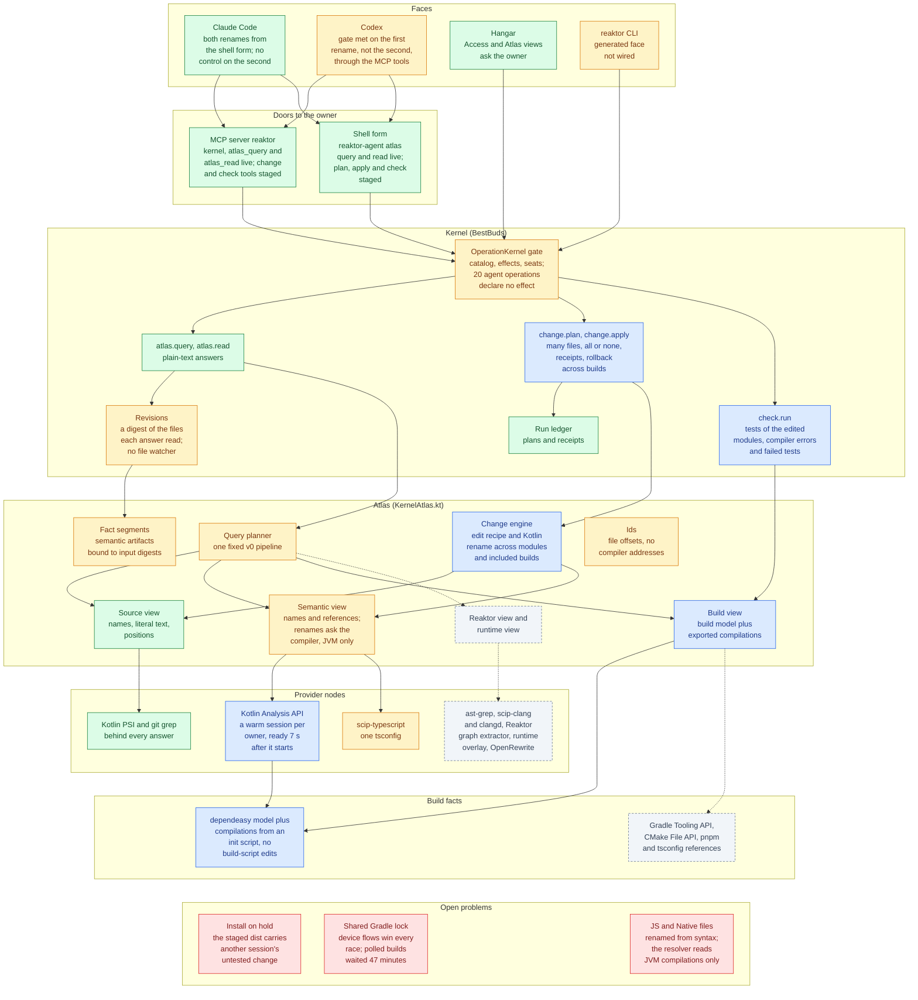
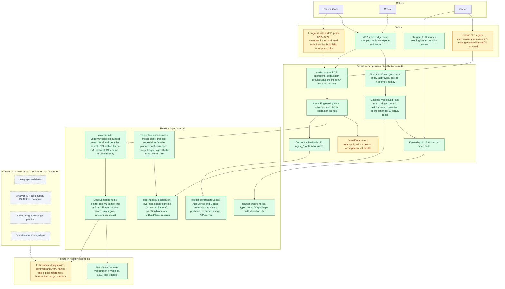
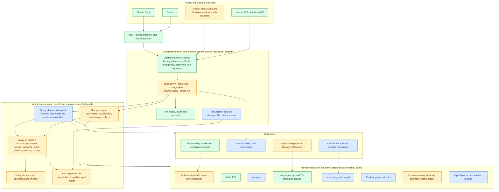
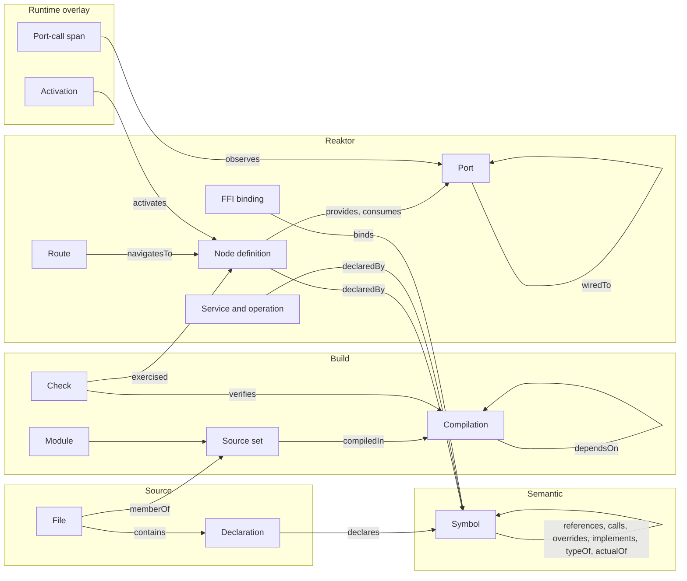
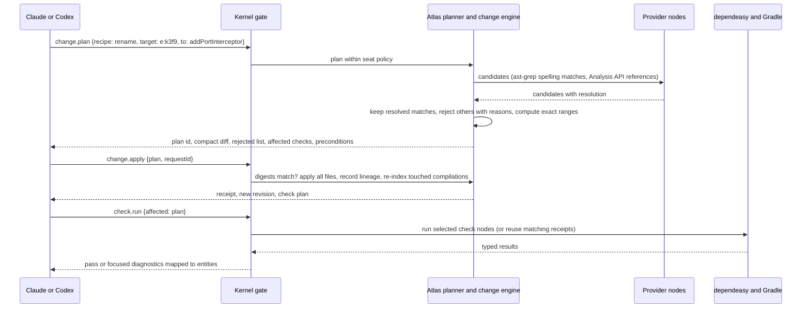

# Reaktor Atlas: one graph interface for coding agents

Written 16 October 2026 by Claude. Not published. Inputs: the Codex tool-experiment handoff ([code-tooling-experiment-handoff.md](code-tooling-experiment-handoff.md)) and its [evidence file](audits/kotlin-tools-20261013-evidence.json), the external review the owner pasted on 16 October, the existing [code/agent HLD](code-agent-hld.md), [kernel plan](reaktor-kernel-plan.md), [kernel handoff](kernel-handoff.md) and [token ROI analysis](token-roi.md), and a source scan of reaktor-code, reaktor-tooling, reaktor-conductor, reaktor-mcp, the graph modules, dependeasy, the BestBuds kernel, the CLI and Hangar. Nothing was built or run for this document, and no model was called.

## 0. Summary

**Proposal.** Build one revision-bound fact graph of the whole workspace, called the Atlas, inside the existing workspace kernel. Every engine we use (Kotlin Analysis API, Kotlin PSI, ast-grep, scip-typescript and the TypeScript language service, clangd and scip-clang, dependeasy, the Gradle Tooling API, the CMake File API, OpenRewrite) becomes a provider node on the kernel's reaktor-graph. Their facts are stored in the graph's own `GraphShape` form, so code, build, app-graph and runtime facts share one shape and one set of identities. Claude, Codex, the CLI and Hangar reach it through five operations in the existing catalog and gate: `atlas.query`, `atlas.read`, `change.plan`, `change.apply` and `check.run`.

**Where we are.** The skeleton is right and the core is narrow. The kernel already derives its operation catalog from graph nodes and serves it to MCP, the CLI and Hangar through one gate. reaktor-code (under 1,000 lines of production code) already projects code facts into `GraphShape`. But Kotlin semantics stop at names and explicit references for common and JVM code, fed by hand-written manifests; the build model exports no compilations; changes are single-file and every one waits for a person; nothing selects affected checks; and code and app graphs are not linked.

**What the experiments decided.** The Kotlin Analysis API resolved 4,841 of 4,841 calls across seven KMP scopes and answers warm queries in 0.096 ms, provided it receives exact compilation inputs. ast-grep is fast but only finds candidates. A compiler-qualified, exact-range rename compiled first time where OpenRewrite's method rename broke the build. scip-java's Kotlin plugin (the maintained successor of the archived scip-kotlin), Kotlin LSP servers and Graphify are not fit for agents today. Most important: tooling that only adds context made a native Codex task 76% more expensive, so the interface must take reads, edits and repair loops away from the agent.

**What reaktor-graph adds.** Every Reaktor+ app is a reaktor-graph declared in regular Kotlin, so the Atlas can see nodes, ports, wiring, routes and services exactly. That turns architecture questions into single queries, stops impact analysis at port contracts, lets tests record the nodes they exercised for exact test selection, enables recipes at architecture level, and joins source definitions to live telemetry through the graph's definition ids.

**Expected improvement.** For a normal week of Kotlin Multiplatform work, the target is 25-45% fewer input tokens and 20-35% fewer requests per accepted task, with 60-90% savings on structural questions and on refactors that have a qualified recipe. These are targets for the matched-task measurement in §5.4, and they depend on agents using the Atlas in place of whole-file reads. The first measurement (§5.5, 17 October) covered code questions only. Codex with the Atlas was as correct as with rg and file reads, and read 15% fewer new tokens, but its total input was 8% higher. Three real edits (§5.6) showed the same pattern: equally correct, 31% fewer new tokens and 16% more input in total, and Codex never used the kernel's edit path. Later that day, answers that list a declaration's uses with their text mentions, and what it calls, removed the extra searches and reads they targeted (A1 now costs what the control costs, and T3 22% less), but across all tasks Codex with the Atlas still used 13-14% more input in total than a control run the same evening (addendum to §5.6). That night, complete answers (every use and mention of a name in one call, possible uses kept apart, and what a whole file uses) brought it below the control: 16% less total input on the five questions and about the same on the three edits, 11% less across all eight, with every answer and diff correct (second addendum to §5.6). The edits still take more rounds than the control. A rerun at 19:00, after one call could carry several lookups, cut the question rounds by a quarter and left total input equal to the control; the edits still took four more rounds, because Codex keeps its own shell rounds and adds the Atlas rounds on top (third addendum). At 20:20, with each source block sent only once per session, Codex with the Atlas used 4.2% less total input than a same-time control across all eight tasks, with 9 rounds against 14.5 on the questions and 17 against 16.5 on the edits. The change itself saved only about half a percent, because Codex repeated a block in 2 of 20 runs; the rest is within the control's own variation (fourth addendum). Eight runs per task settled it at 21:40: with the Atlas, Codex uses 6% less total input on the questions (cheaper in 7 of 8 passes, 9 rounds against 16) and 4.5% more on the edits (cheaper in 3 of 8, 18 rounds against 15.5). The Atlas arm's cost varies far less from run to run than the control's (fifth addendum). With the edit harness fixed to match the real checkout, the edits cost 15% more with the Atlas (19.6 rounds against 15.2), because Codex runs each Atlas call in a round of its own while the control packs its lookups into shell commands it needs anyway (sixth addendum). Called from the shell instead (`reaktor-agent atlas query '{...}'`), a lookup shares one command with the guide read and `git status`, and the edits cost 5% less than the control with 14.2 rounds against 16.6, although eight passes cannot yet rule out no difference (seventh addendum). On 18 October `workspace install` set the shell form up for Codex (a sandbox profile that allows connections to this machine only, and `reaktor-agent` on the PATH), and eight passes each measured it with two fixes (eighth addendum). The questions cost 18.9% less than the control, but most of that gain came from outside the harness: one MCP call now costs what one shell call costs, and at 21:40 it cost about half as much again. The edits cost 12% more than the control, almost all in T2: a fix meant to shrink T2's first answer did shrink it, but its windows hid the lines T2 changes, and two T2 lookups stalled for 35 seconds.

**First steps.** Export compilations from dependeasy; extend the Kotlin producer to calls, types and compiler addresses with warm sessions in the kernel; ship `atlas.query`, `atlas.read` and a compiler-guided Kotlin `rename` through `change.plan` and `change.apply`; let agent seats apply deterministic in-scope plans without a person. The first gate is a real cross-module Kotlin rename done from both Claude and Codex with no whole-file reads and passing affected checks.

### Status at a glance (20 October, 13:00)



Green works today for its stated scope. Blue is built and tested, but runs only from the staged dist on the gate's temporary owner; the live owner gets it when the install goes ahead (red box 1). Amber exists but is narrow, incomplete or only under an older name. Grey, with a dashed border, is designed and not started; each grey box lists the parts of its tier that have not started. Red boxes are open problems, and each names the part it affects. Dotted arrows are connections the design plans and the code does not make yet. The boxes follow §4.2, and §9 has the detail.

On 19 October: `change.plan` (an `edit` recipe and a Kotlin `rename`), `change.apply` (all files or none, across included builds, with receipts and rollback) and `check.run` (the tests of the edited modules, with compiler errors and failed tests) are MCP tools and shell commands. Compilations are exported by an init script, without build-script edits. A rename asks a warm Analysis API session which matches are uses, renames overrides and expect/actual partners with the target, and lists every match it leaves with the reason, including mentions outside Kotlin code. The three problems the eighth addendum found are fixed in the same staged dist: a window now shows the whole statement around a result, `path` beside `from` lists the uses in that file, and an answer stops within a time budget. Between 16:42 and 18:15 the first completion gate ran on a reaktor worktree with two renames, each across three modules. On a top-level function (24 edits), Codex through the MCP tools and Claude from the shell each used one query, one plan checked by the compiler, one apply and one check, with no whole-file reads, and the five affected checks passed. On an extension function (37 edits), the kind of symbol the gate names, Claude did the same and the seven affected checks passed, but it has no control run. Codex cost the same with and without the Atlas there, and its pass with the change tools read the declaring file whole before planning. So the gate is met on the top-level function and not yet on the extension function (§5.7). The extension rename's first plan was refused, because a test compilation saw its module's main code twice; the resolver now leaves a module's own build outputs off its test classpath.

| Measured (eight passes per task unless the row says otherwise) | Total input against a same-time control |
|---|---|
| Five code questions, Atlas through the MCP tools (17 October, 21:40) | 6% less, 9 rounds against 16 |
| Five code questions, Atlas from the shell (18 October, 13:00) | 18.9% less, 9 rounds against 13.8; most of the gain came from outside the harness, because one MCP call now costs what one shell call costs |
| Three edits, Atlas through the MCP tools (17 October, 23:15) | 15% more, 19.6 rounds against 15.2, because Codex runs each Atlas call in a round of its own |
| Three edits, Atlas from the shell (18 October, 00:30) | 5% less, 14.2 rounds against 16.6; eight passes cannot rule out no difference |
| Three edits, shell form with the long-declaration windows (18 October, 13:00) | 12% more, almost all in T2 (35% more) |
| Gate, top-level function, Codex through the MCP tools, one pass (19 October, §5.7) | Met the gate. 85% less: 7 rounds against 18, 45 seconds against 299. Most of the control's cost went into a test crash caused by a stale Gradle daemon |
| Gate, top-level function, Claude from the shell, one pass (19 October, §5.7) | Met the gate. 49% less up to the first test result: 13 rounds against 24, 149 seconds against 259. Claude ran as fresh subagents, because headless `claude -p` needs a new sign-in |
| Gate, extension function, Codex, two passes with the same setup (19 October, §5.7) | Not met yet. About the same either way: 6 rounds and about 190,000 input tokens. One pass renamed with a script and ran only the JVM tests; the other used the change tools, which ran all seven checks, but read the declaring file whole first |
| Gate, extension function, Claude from the shell, one pass (19 October, §5.7) | Met, apart from the comparison: no control was run. 16 rounds and 1.7 million input tokens up to its check, three rounds more than on the top-level function |

## 1. Where things stand

The layer has a sound skeleton and a narrow core.

The skeleton is the BestBuds kernel. It is one reaktor-graph, `KernelGraph`, with fifteen nodes wired through typed ports, hosting an `OperationKernel` whose catalog is derived from the operation and tool nodes attached to that graph. One gate applies the effect policy, single-use approvals, a call log and request replay. Agents reach it through two MCP tools, `workspace` and `kernel`, on a stdio bridge that stamps the harness's seat. The CLI and Hangar reach the same graph in-process.

The core is reaktor-code: under 1,000 lines of production code that give bounded reads, literal and identifier search, PSI outlines, and a semantic index loaded from a SCIP-shaped artifact. Two helpers produce that artifact: scip-typescript for one tsconfig, and the Kotlin Analysis API for declared common and JVM modules, covering names and explicit references only. The kernel can investigate a symbol within 12,000 characters and apply a single-file literal edit or a file-local TypeScript rename, each after a person approves. Everything the 13 October experiments proved beyond that (resolved calls and types, JS and Native compilations, compiler-guided multi-file rename, ast-grep, OpenRewrite) is not integrated.

### 1.1 Current architecture

This is the state on 16 October, before the build started. "Status at a glance" in §0 shows where each part of the proposed design stands now.



Green works today for its stated scope. Amber exists but is unwired, narrow or blocks agents. Grey was proved in the experiment and is not integrated. Dashed arrows are connections that are configured but fail or are missing: the installed Hangar build lists `workspace` and answers "Unknown tool" when this session called it on 16 October (the 16 October Hangar scan traced this to a launchd owner running a classpath copied on 7 October), and BestBuds has no `.codex/config.toml` although AGENTS.md names one.

### 1.2 Component map

| Component | Where | What it does today | State on 16 October |
|---|---|---|---|
| Kernel graph and gate | BestBuds `KernelGraph`, `ReaktorKernel`; reaktor-tooling `OperationKernel` | Fifteen nodes on typed ports. The catalog is rebuilt from attached `OperationNode`s and `ToolNode`s on every call. Seat policy (default: allow up to `LiveRead`, ask up to `Destructive`), single-use approvals that expire after 15 minutes, a call log, replay of the last 256 effectful request ids in memory | Working; kernel K0 committed on 15 October |
| Operation catalog | `KernelOperations.kt` | Typed `build.list/show/tree/plan/run/receipts` and `run.list/show/logs/wait/cancel`; bridged `code.read/query/investigate/plan/receipt`, `context.query`, `task.*`, `check.*`, `provider.*`, `peer.exchange`; 19 legacy read tools | Working. `code.apply`, `provider.call` and `inspect.*` stay outside the catalog and its gate |
| `workspace` tool | `KernelEngineering.kt` | 29 operations with schemas and character budgets (12,000 for investigation and candidates, about 22,000 for queries, outlines and context packets) | Working |
| MCP faces | `KernelAgentMcpHost` (stdio), `ReaktorDesktopMcp` (HTTP), owner `/mcp` | Stdio serves `workspace` and `kernel` and stamps the launch seat. The desktop server is loopback-only, unauthenticated and refuses effects. The owner has a bearer token in `connection.json` | Stdio works. The installed desktop build lists `workspace` and fails the call. Seats are labels, not identities |
| CLI | `targets/reaktorCli` | Legacy `build`, `run`, `inspect`, `tools` commands, `workspace OPERATION --args`, `mcp`. A generated `reaktor <domain> <verb>` face with exit codes 0 to 3 | `KernelCli` is not wired into `Main.kt` |
| Hangar | `targets/reaktorDesktop`, `modules/engine` workbench | Twelve modes reading kernel ports in-process. Build panes read `model.json` directly. The Source pane uses the Kotlin language server through `CodeIntelligence` | No pane shows `code.*` results; the editor path and the agent path are separate |
| reaktor-code | `CodeWorkspace`, `CodeSemanticIndex`, `KotlinSyntax`, `CodeWorkspaceNode` | Bounded reads, literal and identifier search, PSI outline, a SCIP-shaped artifact index projected into a `GraphShape`, investigation, `literal-v1`, `scip-local-rename-v1`, single-file digest-checked apply | Working for one indexed target at a time. The index re-hashes every source and binary input, including the JDK image, on each request |
| Kotlin helper | `reaktor-code/tools/kotlin-analysis` | Analysis API 2.5.0-Beta2-59 over a hand-written `reaktor-kotlin-target-v1` manifest: common and JVM modules, named declarations and explicit name references, offset-based symbol ids | Narrow. Rejects any semantic error, plugin or other platform |
| TypeScript helper | `reaktor-code/tools/scip-index.mjs` | scip-typescript 0.4.0 with TypeScript 5.9.3 over one tsconfig without project references | Working for one target |
| reaktor-tooling | `operation`, `mcp/door`, `SupervisedProcessExecutor`, Gradle planner and ledger, `KotlinSourceIndex`, `PackageWorkspaces`, `lsp` | Operation vocabulary and gate, MCP door and approvals, process supervision, Gradle plan and run through the wrapper with request files, receipt ledger, a regex index of top-level Kotlin types, a pnpm workspace reader, the editor's Kotlin LSP session | Working. No Tooling API connection, no CMake reader, no compile-commands reader |
| reaktor-conductor | `appserver`, `cli`, `workspace` | Codex App Server and Claude stream-json runtimes (qualified against Codex 0.154.0 and Claude Code 2.1.270), protocols, evidence and acceptance, usage accounting, an A2A 1.0 server, 50 `agent_*` tools in one `ToolNode`, 214 tests | Working. It does not import reaktor-code and uses no graph ports |
| dependeasy | `model`, `gradle` | Schema-3 `model.json` of declared build nodes (584 nodes, 107 edges, 44 projects in the current Reaktor export), declaration sites, Gradle plans through `planBuildNode` (its `GradleInvocationTask` already uses the Tooling API for a dry-run), receipts from a `BuildEventsListenerRegistry` service (445 on disk) | Working for declarations, plans and receipts. It exports no compilations, source sets, classpaths, generated roots or project dependencies, and nothing evaluates its file inputs. The current export is stale because `local.properties` is a declared input |
| Native and web build facts | dependeasy `native`, `web` | CMake runs with `CMAKE_EXPORT_COMPILE_COMMANDS` on and a CMake File API codemodel query used only for static-library closure. A web contract and generated tsconfig per component; `tsc --build` checks | `compile_commands.json` files exist and nothing reads them. No lockfile parsing |
| reaktor-graph | `graph-runtime` `GraphShape`, `GraphDefinition`; `graph-port` | Live shapes with definition ids for scopes, nodes, ports and wires and a definition digest; ids flow into telemetry spans and service calls. Typed ports with interceptors, attachments and visitors | Working. Type names are simple names, nothing records a source site, the authored `GraphDefinition` IR has no producer, and no static view of graphs exists |
| reaktor-compiler | `FlexCoderProcessor` | A KSP processor that generates FlexBuffer coders for `@Struct` | Emits no graph facts; `ReaktorProcessor` is an empty slot |
| reaktor-ffi | `Runtime.h`, `interop {}` DSL | A `(module, operation, JSON)` bridge between Kotlin, C++ and TypeScript, with installers generated from the dependeasy DSL | No per-symbol binding manifest |

### 1.3 What is missing, most important first

1. **The build does not describe compilations.** The model has no Kotlin compilations, source sets, generated roots, classpaths, klibs, compiler plugins or project dependencies. The Kotlin helper therefore needs hand-written manifests, cannot see Compose or serialization plugins, and cannot cover JS, Native or Android. This is the root cause of the narrow semantic coverage, and the experiment showed that supplying exact inputs is what makes the Analysis API correct.
2. **Kotlin semantics stop at names.** The integrated producer records named declarations and explicit references for common and JVM modules. Calls, inferred types, overloads at call sites, overrides and expect/actual links are missing, and symbol ids are file offsets that change with every edit above them.
3. **There is no multi-file semantic change.** Plans are a literal replacement or a file-local TypeScript rename, applied to one file. Every apply waits for a person and for an idle workspace, so agents edit with their native tools.
4. **Nothing selects affected checks.** There is no affected-target logic anywhere, no map from source sets to build nodes, and dependeasy's file inputs are written but never evaluated. Agents rebuild modules and read raw output.
5. **Code and graphs are not joined.** reaktor-code knows symbols, the graph knows live definitions, and nothing links them: no static view of graphs, no source sites, simple class names in shapes. Architecture questions still mean reading constructors across modules.
6. **The agent surface is fragmented.** There are three MCP servers with different authentication, operations outside the gate, an unwired CLI face, 50 conductor tools behind one tool node, and installed binaries that lag the source. AGENTS.md still describes the older door, and BestBuds has no Codex MCP configuration.
7. **Agents use the tools on top of their old workflow.** The 12 October comparison cost 76% more fresh input with tooling because agents also read the whole files. Nothing yet replaces the read, the edit or the build loop.

## 2. What the experiments tell us

The 13 October experiments ran on m1-worker over a frozen corpus of 3,059 authored Kotlin files (19.7 MB) from Reaktor, BestBuds and Manna. They made no production edits and called no models. The 11 and 12 October runs measured real native Codex sessions. All 31 positive assertions in the evidence file replayed on 16 October. Six conclusions follow, most important first.

**1. The Kotlin Analysis API is accurate across our KMP code once it has the exact compilation inputs, and it is fast once warm.** It resolved 4,841 of 4,841 call expressions in seven scoped contexts: common/JVM, common/JS, iOS Native with Foundation and cinterop, the graph ports, a BestBuds model, Manna's date library and a 61-file BestBuds Compose scope. It told apart overloads, import aliases, extension functions, suspend calls and inferred return types. A cold scope took 2 to 11 seconds and 350 to 800 MiB. A warm repeated call resolution took 0.096 ms. The Compose scope reported 168 missing-resource errors until the four generated Kotlin resource files were added. Semantic accuracy is therefore a build-layer question: whoever supplies the source sets, generated sources, dependsOn edges, klibs, jars and compiler plugins decides whether the answer is right.

**2. Tooling that adds context without removing work costs more.** In the 12 October matched Codex runs (rename `Sealed.nonce` to `iv` across two Crypto files, two pairs, all four attempts correct), the tooling arm used 76% more fresh input and 29% more time. The agents read the complete files anyway and then also read the graph context. In the 11 October bounded-question run, one investigation replaced four reads and known operations ran without discovery calls: structured output fell from 8,172 to 2,008 bytes, MCP calls from three to one, generations from five to three and fresh input from 18,898 to 11,475 tokens. Both samples are small. Together they show that the interface must take reads, edits and repair loops away from the agent. A better answer that sits beside the old workflow raises the cost.

**3. Syntax tools find candidates, and the compiler decides identity.** ast-grep scanned all 3,059 files in 2.1 seconds with 58 MiB of memory. It also reported 516 grammar ERROR nodes in 154 files, about 5% of the corpus and mostly Compose syntax. In the rename experiment it produced eight identifier candidates for `addInterceptor`. The Analysis API kept the four real references and rejected four unrelated ones: an unrelated member, a local function-valued variable and their calls. A small patcher converted UTF-16 offsets to UTF-8 byte ranges and applied the four edits. The code compiled and behaved the same, and a second pass had nothing left to do. sed was not run; the fixture shows that a global substitution would have changed the unrelated names.

**4. OpenRewrite is a good engine for some typed JVM recipes and a poor default.** It parsed and printed 3,057 of 3,059 files in 44.5 seconds with 5.4 GiB of memory, and type-attributed 156,928 of 236,054 method invocations with one shared JVM classpath (all 489 of 489 in the graph scope with its real classpath). Its `ChangeType` recipe migrated `PortInvocation` to `PortCall` across four files, compiled and behaved the same. Its `ChangeMethodName` recipe failed on the same Kotlin extension function that the compiler-guided path renamed correctly: it changed one call, left the declaration and imports, and the result did not compile. Its second pass still reported zero changes, so idempotence says nothing about correctness. OpenRewrite's JavaScript and TypeScript module is published under Moderne's source-available licence, and Swift is not supported.

**5. External Kotlin indexers lag the compiler.** The experiment ran the right project: scip-java, which absorbed the Kotlin plugin when sourcegraph/scip-kotlin was archived in July 2026. Its published 0.13.1 Kotlin plugin failed at once on Kotlin 2.4.21 with an `AbstractMethodError` in its compiler-plugin registrar. The official Kotlin LSP listed KMP as future work, and the reviewed community KMP server used word search for references. Producing Kotlin facts ourselves on the Analysis API, and keeping SCIP as the storage and exchange shape, removes this dependency.

**6. Flow analysers answer questions graph traversal cannot, at a real cost.** CodeQL found 7 of 8 synthetic flows and Joern 8 of 8, but Joern crashed on the real common/JVM Crypto code and found 6 of 9 JCA lineage cases. First queries took 4 to 42 seconds. They belong behind a specific security or data-flow question and should run on demand.

| Tool (version run) | What happened | Decision |
|---|---|---|
| Kotlin Analysis API standalone (2.5.0-Beta2-71) | 4,841/4,841 calls resolved in 7 KMP scopes; 0.096 ms warm; 2-11 s and 350-800 MiB cold | Default Kotlin semantic engine, run warm inside the kernel |
| ast-grep (0.50.0) | 3,059 files in 2.1 s; ERROR nodes in 5% of files; 8 candidates, 4 qualified edits | Polyglot candidate finder and structural rewriter; never the identity source |
| Exact range patcher | 4 edits, compiled, behaviour unchanged, idempotent | Default edit engine for every recipe |
| OpenRewrite (8.90.4) | ChangeType passed; extension ChangeMethodName broke compilation; 5.4 GiB full parse | Optional engine for named, qualified recipes |
| scip-java Kotlin plugin (0.13.1) | Failed on Kotlin 2.4.21 | Not used yet; keep the SCIP shape and scip-java's symbol scheme for our own Kotlin facts, and qualify the first scip-java release built on Kotlin 2.4 |
| Kotlin LSP, community KMP LSP | Reviewed only; no KMP semantics | Editor use only |
| Graphify | Reviewed only; no gain over PSI and the Analysis API | Not used |
| CodeQL (2.27.2), Joern (4.0.654) | Partial results; crashes on real code | On demand for named security questions |

## 3. Which tools help most

The right tools depend on what we actually write. Counting authored files only (vendored Hermes and FlatBuffers excluded): Kotlin has 3,059 files. TypeScript has about 1,100, most of them Manna's web app (632) and API (287), plus BestBuds' companyOS, reaktorWeb and iOS driver scripts, Reaktor's graph-port and performance TypeScript and dependeasy's JavaScript. C and C++ live in reaktor-security's MLS libraries (core, C API, JSI and wasm bindings), reaktor-ffi's runtime kernel and reaktor-flexbuffer. Swift is a handful of app-shell files. Kotlin work therefore carries most of the value, TypeScript is second because of Manna, and C++ matters mainly at the FFI and security boundary.

The table ranks the tools by the value they add to this portfolio. The maintenance evidence was read from GitHub on 16 October 2026.

| Rank | Tool | Role in the Atlas | Why it ranks here | Maintenance |
|---|---|---|---|---|
| 1 | Kotlin Analysis API (standalone) | Symbols, references, calls, types, overrides, expect/actual for every Kotlin compilation | Most of our code; proven accurate on KMP; warm queries cost almost nothing | JetBrains development artifacts, latest 2.5.0-Beta2-71 at the 13 October capture; standalone mode is less stable than the IDE integration, so it stays isolated and pinned |
| 2 | dependeasy model plus a compilation export | The exact inputs per Kotlin compilation, the build graph, checks and receipts | Without it the semantic engine guesses or fails, as the Compose scope showed | Ours |
| 3 | Reaktor graph extractor | Nodes, ports, wiring, routes, services and operations as first-class entities | Every Reaktor+ app is a graph, so architecture questions get exact answers | Ours |
| 4 | Exact range edit engine with compiler-guided recipes | Rename and other symbol-level changes that compile the first time | Removes the read-edit-build-repair loop, which is where the 12 October run lost | Ours (proven in the experiment) |
| 5 | Affected-check selection | Which checks a change needs, with reasons | Shorter verification loops and smaller results | Ours (kernel K3 `build.affected` plus Atlas edges) |
| 6 | Gradle Tooling API | Long-lived build connection with typed progress, test events, cancellation and custom models | Faster, structured build feedback for the kernel | Part of Gradle |
| 7 | ast-grep | Fast structural search and rewrite in Kotlin, TypeScript, C++, Swift and more | Cheap candidate generation and bulk syntactic recipes | 0.51.0 released 15 October 2026; active |
| 8 | scip-typescript plus the TypeScript language service | TypeScript facts and rename for Manna and the web targets | Second-largest language | scip-typescript 0.4.0 released 2 October 2025 with commits through 15 October 2026; Manna uses TypeScript 6.0.3 while the helper pins 5.9.3, and the native TypeScript 7 compiler has shipped (7.0.2 is current), so the language service is the fallback |
| 9 | CMake File API, clangd and scip-clang | C++ targets, compile commands, references and rename at the FFI and MLS boundary | Small code share, high risk per change | CMake and clangd ship with their toolchains; scip-clang 0.4.0 released February 2026, commits through 11 October 2026 |
| 10 | OpenRewrite (Apache-licensed core) | Named Java/Kotlin migrations once a recipe is qualified | Useful for some type migrations; heavy and wrong on extensions | 8.93.8 released 15 October 2026; very active |
| 11 | SourceKit-LSP and swift-syntax | Swift navigation and rewriting | Almost no Swift today | Swift 6.4 / swift-syntax 604.0.0, September 2026 |
| 12 | Joern, CodeQL | On-demand flow and security questions | Narrow, expensive | Joern 4.0.657 (16 October 2026), CodeQL 2.27.2 (7 October 2026) |

Three tools stay out for now. scip-java's Kotlin plugin 0.13.1 fails on our compiler; its main branch moved to Kotlin 2.4.21 on 8 October, but no release has followed, and its Gradle trigger only covers JVM compilations. Kotlin LSP servers do not give KMP semantics to agents, although the editor keeps using one. Graphify adds nothing over PSI and the Analysis API for code.

## 4. Proposed HLD

### 4.1 The idea

Two pieces that already exist fit together. The workspace kernel builds its operation catalog by walking its own graph: `OperationKernel` collects every `OperationNode` attached to the kernel graph, and the CLI, MCP and Hangar all read that one catalog. reaktor-code already stores source facts in the graph's own inspection shapes: `CodeSemanticIndex` turns files and symbols into `NodeShape`s inside an inactive `ScopeShape`, and definitions and references into `WireShape`s.

The proposal joins them. Every engine (Kotlin Analysis API, Kotlin PSI, ast-grep, scip-typescript and the TypeScript language service, clangd and scip-clang, the dependeasy model, the Gradle Tooling API, the CMake File API, OpenRewrite) becomes a provider node on the kernel graph. Their facts go into one revision-bound fact graph, the **Atlas**, which uses the same shapes as the live app graphs. Agents, the CLI and Hangar reach the Atlas through five operations: `atlas.query` to find and traverse, `atlas.read` to read exactly the code they need, `change.plan` and `change.apply` to change code through compiler-checked recipes, and `check.run` to verify only what the change affects. These five sit in the existing catalog beside `build.*`, `run.*` and `task.*`, behind the existing gate.

The design has one aim: an agent should finish a task with fewer requests and less code in its context than it would need with grep, whole-file reads and native edits. Every element below is judged by that.

### 4.2 Proposed architecture



Green exists today, amber exists and must be extended, blue is new. Read the diagram from the top. A face sends one operation to the kernel. The gate checks the effect against the caller's seat and asks a person only when the policy says so. The five Atlas operations go to the planner (reads) or the change engine (writes). Both work on views of the fact graph, which are built from fact segments. A segment is produced by a provider node for one compilation and one set of input digests, so it is reused until those inputs change. The build facts tell every provider what a compilation contains.

### 4.3 The Atlas

**Entities.** The Atlas holds a small set of entity kinds, grouped into views:

| View | Entities | Produced by |
|---|---|---|
| Source | repository, file, declaration | file system, git, Kotlin PSI, ast-grep |
| Semantic | symbol (class, interface, object, function, property, type alias, parameter, local), type | Kotlin Analysis API, scip-typescript, scip-clang, clangd |
| Build | build, module, source set, compilation, external artifact, build node, check, artifact | dependeasy, Gradle Tooling API, CMake File API, pnpm and tsconfig |
| Reaktor | graph, node definition, port, wire, route, service, operation, FFI binding | Reaktor graph extractor, kernel catalog, reaktor-ffi declarations |
| Runtime overlay | activation, port-call span, test activation | devtools and rgp, reaktor-telemetry, the test recorder |
| Change overlay | plan, receipt, check result, finding | kernel ledger, conductor evidence |

**Relations and evidence.** Every relation carries a kind, an evidence strength, the producer and its version, and the digest of the inputs it was computed from. The strengths are: `declared` (written in a build script or graph DSL), `syntactic` (PSI, ast-grep), `resolved` (a compiler or type checker), `observed` (runtime or a test run) and `inferred` (a heuristic join, for example wiring matched by port type). A query states the minimum strength it needs. The planner never answers a `resolved` question from `syntactic` facts; it reports the gap instead.



**Identity.** Each entity gets a stable `EntityId` minted by the Atlas, plus the addresses its producers use. Addresses follow the SCIP symbol syntax so one string format covers Kotlin, TypeScript and C++; Kotlin and Java use scip-java's scheme (`semanticdb maven <group> <artifact> <version> <descriptor>`), so a future scip-java index and our own producer name the same symbol the same way. The current Kotlin producer identifies a symbol by its file path and character offset (`kotlin <module>/<path>#<offset>`). That address changes whenever text above the declaration changes, so a fact store keyed on it would be invalidated by almost every edit. Kotlin addresses should come from the compiler instead: the class id, or the callable id with its receiver and erased parameter types, plus the source set. Locals keep a file-scoped address. When `change.apply` renames or moves a symbol, it records the old and new address against the same `EntityId`. When an edit happens outside the Atlas, re-indexing links a vanished address to a new declaration with the same signature in the same file and marks that link `inferred`. Agents receive handles made of the `EntityId` and the revision, so a stale handle is detected and either re-resolved or rejected.

**Revisions and freshness.** A revision is the set of file digests across the workspace's repositories, including uncommitted changes. The kernel's file watcher reports changed files. The Atlas then invalidates only the facts whose input digests include those files: syntax facts per file, semantic facts per compilation segment, build facts per build-script digest. Every response names the revision it answers for and lists any stale or partial parts.

**Storage.** Three tiers, as the existing HLD already prescribes:

- A small durable core: entity ids, addresses, lineage, build and Reaktor declarations.
- Immutable fact segments, one per compilation and input digest, produced by a provider. Because they are content-addressed, another worktree or m1-worker can reuse a segment with the same inputs. The first segment format is today's `reaktor-scip-v1` JSON. It is bounded at 16 MiB, 4,096 documents and 200,000 occurrences. When a real compilation exceeds that, segments move to a binary encoding; reaktor-flexbuffer is the obvious candidate because it is ours and can be read without parsing.
- Views computed on request: impact cones, call paths and wiring maps, returned as `GraphShape` subgraphs, as `CodeSemanticIndex.sourceGraph` does now.

**The shape is the graph's own.** Each Atlas view is an inactive scope of the same `GraphShape` family that describes live app graphs. This is what makes the Atlas part of reaktor-graph: it is one more set of scopes in the graph's own shape. Hangar's blueprint renderer, the devtools wire and rgp/1 can carry Atlas results unchanged, and one traversal library serves both static and live graphs.

### 4.4 Providers are graph nodes

Each engine is a node on the kernel graph that provides one or more typed capabilities:

| Capability | What it answers | Providers |
|---|---|---|
| `SyntaxFacts` | outlines, declarations, structural matches | Kotlin PSI, ast-grep |
| `SemanticFacts` | resolve, references, calls, types, hierarchy, expect/actual | Kotlin Analysis API, scip-typescript, TypeScript language service, scip-clang, clangd |
| `BuildFacts` | modules, compilations and their inputs, checks, receipts | dependeasy, Gradle Tooling API, CMake File API, pnpm and tsconfig |
| `ReaktorFacts` | graphs, nodes, ports, wiring, routes, services, operations, FFI bindings | Reaktor graph extractor, kernel catalog |
| `RuntimeFacts` | activations, port-call spans, test activations | devtools and rgp, reaktor-telemetry, test recorder |
| `Rewriter` | candidate edits for a recipe | Analysis API, ast-grep, TypeScript language service, clangd, OpenRewrite |
| `CheckRunner` | run checks and return typed results | dependeasy nodes through Gradle |

Each provider node publishes a capability profile: languages, platforms, operations, evidence strength, cold and warm cost, memory, whether it can be cancelled, and its version. The Atlas finds providers by walking its graph, exactly as `OperationKernel` finds `OperationNode`s. Attaching a node registers the capability and detaching it removes it. A query that needs a missing capability returns `PROVIDER_UNAVAILABLE` and names the provider; it does not fall back to a weaker answer.

Graph scopes give providers their lifetimes. A warm Analysis API session lives in a child scope for its compilation group, and closing the scope frees its 350 to 800 MiB. The kernel keeps a small least-recently-used set of warm scopes under a memory budget. Everything else is indexed in the background at low priority, or on m1-worker when the Mac is loaded, and comes back as segments. Port interceptors, which the graph already has, enforce per-call time and byte budgets, emit a reaktor-telemetry span per provider call, and charge the cost to the task that asked.

The dependency direction stays as it is. reaktor-code defines the Atlas and the capability contracts and keeps its boundary (no tooling, LSP4J, UI or product dependency). reaktor-tooling, which already depends on reaktor-code, hosts the provider nodes that launch processes and speak to engines. The graph connects them through typed ports, so the Atlas never imports an engine.

### 4.5 The agent interface

Five operations carry almost all agent work. They share one request style and one response envelope.

| Operation | Purpose | Replaces |
|---|---|---|
| `atlas.query` | Find entities and follow relations; presets for common questions | grep, find, Explore subagents, chains of whole-file reads |
| `atlas.read` | Exact source for an entity: declaration, body, signature or file outline, with the resolved signatures it uses | whole-file reads |
| `change.plan` | A typed recipe against a target; returns a plan, a compact diff, rejected candidates with reasons, affected checks and preconditions | reading every affected file, native edits, sed |
| `change.apply` | Apply one plan by id with a request id; atomic, digest-checked, receipted, re-indexed | native edits and their repair loop |
| `check.run` | Run the checks a plan or revision affects; compact results mapped to entities; receipt reuse | full builds and raw build logs |

Long runs use the existing `run.show`, `run.wait` and `run.cancel`. Continuity uses conductor's `task.context` and `task.checkpoint`, which store Atlas handles so a new session can re-read exactly what it needs. Everything else stays reachable through `operation.catalog` and `operation.describe`.

**Selectors** name a starting point the same way in every operation:

| Selector | Example |
|---|---|
| handle | `{"id": "e:k3f9"}` |
| name | `{"name": "ConsumerPort.invoke", "kind": "function"}` |
| position | `{"path": "reaktor-graph/.../Port.kt", "line": 41, "column": 8}` (zero-based, UTF-16, as today) |
| file | `{"path": "manna/targets/api/src/routes.ts"}` |
| pattern | `{"pattern": "$G.addInterceptor($$$)", "language": "kotlin"}` |
| build entity | `{"module": ":reaktor-graph", "sourceSet": "commonMain"}` |
| Reaktor entity | `{"port": "AuthApi"}`, `{"route": "Settings"}`, `{"operation": "build.run"}` |
| change set | `{"changed": "worktree"}` or `{"changed": "origin/main"}` |

**Traversal** is a list of steps, each a relation kind with a direction and a depth of one to four: `contains`, `declares`, `references`, `calls`, `overrides`, `implements`, `typeOf`, `actualOf`, `memberOf`, `compiledIn`, `dependsOn`, `verifies`, `provides`, `consumes`, `wiredTo`, `navigatesTo`, `binds`, `observed`. A request also names the fields to show, the minimum evidence it needs and a byte budget.

**Presets** are stored queries with no special engine support: `map` (the workspace in about 2 KB: builds, modules with one-line purposes, graphs and entry points, recent changes, the open task), `investigate` (today's `code.investigate`), `explain` (what a module, node, port, service or operation is, what wires to it and what checks it), `impact` (dependents across compilations plus the checks that cover them, each with a reason), `wiring` (providers and consumers of a port type across graphs) and `affected-checks`.

A request and its response:

```json
{"op": "atlas.query", "args": {
  "from": {"name": "addInterceptor", "kind": "function"},
  "follow": [{"rel": "references", "dir": "in"}],
  "show": ["location", "snippet"], "need": "resolved", "budget": 6000}}
```

```json
{
  "revision": "rev:9c41",
  "items": [
    {"id": "e:k3f9", "kind": "function", "name": "addInterceptor",
     "signature": "fun Graph.addInterceptor(interceptor: PortInterceptor)", "at": "reaktor-graph-port/src/commonMain/kotlin/.../Interceptors.kt:41:5"},
    {"id": "e:p2a1", "kind": "reference", "from": "e:k3f9", "at": "reaktor-core/src/commonMain/kotlin/.../Setup.kt:88:9",
     "snippet": "graph.addInterceptor(TelemetryInterceptor(spans))"}
  ],
  "counts": {"total": 4, "shown": 4},
  "evidence": {"strength": "resolved", "producers": ["kotlin-analysis-api/2.5.0-Beta2-71"], "stale": []},
  "omissions": ["Generated sources of :reaktor-core jsMain are not indexed"],
  "next": [{"op": "change.plan", "args": {"recipe": "rename", "target": {"id": "e:k3f9"}, "to": "?"}}]
}
```

The `next` field carries ready-made follow-up calls built from the returned handles. The agent can send the next step without composing it from scratch and without an `operation.describe` round trip. Counts are always complete even when the byte budget cuts items, and the budget is enforced before serialization, so the JSON is never truncated.

**Projections.** MCP exposes one `reaktor` tool for every operation, with progressive disclosure through the catalog, plus five direct tools for the five operations above with their schemas inline (the kernel handoff's K9 step 3 and decision D5). The CLI exposes the same operations as `reaktor atlas query --json` and so on, with identical JSON. Hangar draws query results and views with blueprint in Atlas, Code and Build panes. All of them go through `OperationKernel.invoke`, so requests, approvals, call logs and receipts are shared.

### 4.6 Query planning

For each request the planner resolves the scope and revision, works out what evidence the question needs, reuses current segments when their input digests match, and otherwise runs the cheapest available provider whose profile meets that evidence. Results come back with their evidence and their omissions. A timeout, a missing classpath or an unsupported target becomes an explicit omission or an `UNSUPPORTED_SCOPE` error.

| Question | First choice | Next choice | Evidence |
|---|---|---|---|
| Declarations by name | durable core index | PSI outline of candidate files | syntactic |
| References or callers of a Kotlin symbol | semantic segment | warm Analysis API session | resolved (no text fallback unless the caller asks for `syntactic`) |
| Code matching a pattern | ast-grep | Kotlin PSI for files where the grammar reports ERROR nodes | syntactic |
| Type of an expression, overload at a call | warm Analysis API session | none | resolved |
| TypeScript references | scip-typescript segment | TypeScript language service | resolved |
| C++ references | scip-clang segment | clangd | resolved |
| Providers and consumers of a port | Reaktor facts | runtime overlay | declared, resolved, observed |
| Checks affected by a change | build view joined with semantic and Reaktor impact | full module checks, reported as conservative | declared and resolved |
| Data flow or taint | Joern or CodeQL, scoped, on request only | none | inferred |

### 4.7 Changes and verification



A plan is computed in five steps. The target resolves to exactly one entity; an ambiguous target returns the choices and never edits the first match. The recipe engine collects candidates from the semantic provider and, for coverage, from ast-grep spelling matches. Each candidate is qualified by resolution: kept if it resolves to the target, rejected with a reason otherwise, and reported if it cannot be resolved. Exact ranges are computed with UTF-16 to UTF-8 conversion, CRLF preserved, and imports and aliases handled. The plan is stored with the digest of every file it touches, the compact diff, the affected checks and the approval the seat policy requires.

Applying a plan checks every digest, writes all files through temporary files and renames, and records a receipt. If a write fails part-way, the receipt is marked uncertain and the retained originals are restored before anything else runs. Renames and moves record lineage. Touched compilations are re-indexed before the new revision is returned. Retrying with the same request id returns the same receipt.

The recipes form a closed set, and each one ships with its own qualification fixtures (aliases, overloads, local shadows, comments and strings, Unicode, CRLF, idempotence):

- `rename`: Kotlin first (class, function, property, extension function, type alias, with overloads, aliases, overrides and expect/actual handled as the recipe declares). This is the experiment's path made into a product. TypeScript renames move to the language service, and C++ renames use clangd.
- `edit`: a replacement the agent writes, anchored to an entity ("replace the body of `e:k3f9` with ..."), with the digest precondition. This lets an agent change logic it saw through `atlas.read` without a native whole-file read and edit.
- `structural`: an ast-grep rule, optionally filtered by resolution, for example only calls whose resolved callee is a given symbol.
- `change-type`: move uses from one type to another, through the Analysis API; OpenRewrite's `ChangeType` is the proven alternative engine.
- `move` and `change-signature`: after `rename` and `edit` are measured.
- `literal`: today's `literal-v1`.
- `openrewrite`: a named recipe from an allow-list of qualified recipes, run on m1-worker when memory requires.

**Authority.** Today every source edit through the tool path waits for a person. `code.apply` bypasses the operation gate, and `KernelDoor.admitCodeEdit` files an approval under the `engineering` seat for every edit, whoever the caller is; the workspace must also be idle. Meanwhile agents edit files freely with their native tools under their own permission mode. A prompt on the tool path therefore pushes them back to native edits and loses every benefit above. The proposal is a seat-policy setting, with no new mechanism: `change.apply` goes through `OperationKernel` like every other operation, and an agent seat may apply deterministic plans inside its own checkout and the task's declared scope without a person. Anything wider, non-deterministic or above `SourceWrite` still asks. The agent channel still never approves anything, and seats become authenticated principals with kernel K10.

**Concurrency.** Plans carry digests, and conflicting applications serialize through the workspace owner's existing admission lock. Parallel agents work in separate worktrees. Segments are keyed by input digest, so a new worktree reuses every unchanged compilation's facts.

### 4.8 The build layer

The Atlas needs five things from the build:

- for every Kotlin compilation: the module, source set and platform, the source files including generated ones, dependsOn edges, module dependencies, the resolved jars and metadata klibs, language and API version, compiler plugins and options, and the JDK;
- for every module: its checks (verify nodes, test tasks, Maestro flows) and the source sets each covers;
- for every TypeScript project: its tsconfig, project references, compiler version and dependencies;
- for every C and C++ target: sources, include directories, defines, flags, toolchain and outputs;
- receipts: which checks ran on which inputs with which results.

**dependeasy** is the source for Gradle builds, and this is the largest piece of new build work. The schema-3 model is declaration-level: it has build nodes, declaration sites, plans and receipts, but no compilations, source sets, generated roots, classpaths, klibs, compiler plugins or project dependencies. dependeasy already holds `CompilationRef`, `SourceSetRef` and `ConfigurationRef` handles in its DSL and visits every Kotlin compilation to publish outputs; it never serializes them. The model should gain a compilations section produced inside Gradle from the Kotlin plugin's own compilation objects, which know every input listed above. That section replaces the hand-written `reaktor-kotlin-target-v1` manifests the Kotlin helper needs today. Generated sources arrive as declared generated roots, which also satisfies reaktor-code's rule against reading arbitrary `build/` paths: the producer reads only roots the build declared. The same section maps source sets to the verification nodes that compile and test them, which is the missing link for affected checks.

Build facts must also survive ordinary staleness. `BuildModelReader.read` throws whenever any declared input changed, and `local.properties` is a declared input, so the current export is stale most of the time and about a quarter of the 445 receipts on disk were produced against a stale model. The Atlas serves the last good build facts with a stale flag, and the export should stop treating machine-local files as declarations.

**The Gradle Tooling API** is used today only inside dependeasy's `GradleInvocationTask`, which runs a dry-run with an init script to compute one node's task plan. No code fetches a Tooling API model, and no `ToolingModelBuilder` exists in any of the three repositories. The proposal gives the kernel a long-lived connection per build root. Through it the kernel asks for typed models (dependeasy registers a `ToolingModelBuilder` for its model and the compilations section, so nothing is parsed from files), runs builds with typed task and test progress events in place of the `@dependeasy-task` console lines, and cancels them with a token. Today `GradleBuildPlanner` starts the wrapper twice per node and writes request files. One constraint matters: `./gradlew` hands every build to `remote-dev`, which places it on m1-worker when the Mac is loaded, and a Tooling API connection bypasses that script. Placement therefore stays with remote-dev: a local connection when the Mac has room, and a worker-side runner that streams the same typed events when it does not.

**C and C++.** CMake already runs with `CMAKE_EXPORT_COMPILE_COMMANDS` on, so every native variant has a `compile_commands.json` under its `build/dependeasy/native` directory, and nothing reads them. dependeasy also already writes a CMake File API `codemodel-v2` query, used only to compute static-library closure. Reading the compile commands is enough to start clangd and scip-clang; extending the File API reader to targets, sources and compile groups gives the build view its C and C++ targets. This covers reaktor-security's MLS libraries, reaktor-ffi's runtime kernel and reaktor-flexbuffer.

**pnpm and TypeScript.** Workspace membership is read in three places today (dependeasy's `WorkspacePatterns`, its JavaScript `packages.ts` and reaktor-tooling's `PackageWorkspaces`), and nothing parses the lockfile. One reader for membership, the lockfile's package graph and each tsconfig's project references turns every TypeScript project into a compilation for scip-typescript and the language service. dependeasy's web contracts and generated tsconfigs already describe the Kotlin/JS components. Manna's web app and API are the first real use.

**Affected checks** follow from the joined views: changed files lead to source sets and compilations, then to dependent compilations; entities whose resolved references reach the changed declarations are added; Reaktor facts narrow the set at port boundaries (§4.9); the checks covering the result are selected, each with a reason. A retained receipt is reused only when its input manifest matches exactly. This is the kernel handoff's K3 `build.affected`, extended from build-input digests to semantic and Reaktor edges.

### 4.9 Using reaktor-graph everywhere in Reaktor+

Every Reaktor+ product is built on reaktor-graph: one global graph, a child graph per session, nodes with typed ports, routes and services. The architecture is therefore written in the code in a regular form that a compiler-backed extractor can read exactly. A generic tool sees classes and calls; the Atlas can see nodes, ports, wiring, routes and services. That gives seven capabilities no generic tool offers.

1. **Architecture questions become single queries.** Who provides `AuthApi`, which nodes consume it, which screens navigate to Settings, which services a client calls, which operations can write source: each is one `atlas.query` with the `wiring` or `explain` preset.
2. **Impact stops at port contracts.** A change inside a node that leaves its port types alone reaches other nodes only through behaviour, so the affected checks are the node's own checks plus the checks that exercise its ports. A change to a port type reaches exactly the wired consumers. File-level dependency closure cannot draw that line.
3. **Tests can report what they touched.** A test that builds a graph can record which node and port definitions it activated, through a recorder installed as a port interceptor in the test harness. That gives each check an `exercised` edge to the nodes it ran, which makes affected-check selection exact at node level without bytecode coverage.
4. **Recipes can work at architecture altitude:** rename a port, move a node to another module, add an operation to an `OperationNode`, wire a new consumer, split a service.
5. **Static and live graphs join.** Definitions carry `definitionId`s, live activations carry the same ids, and telemetry spans are recorded per port call. "Is this port called in production, how often and how slowly" becomes part of the answer about the code.
6. **Tools are nodes.** The kernel catalog is already derived from its graph. Atlas providers, recipes and checks are nodes too, so adding a provider means attaching a node, and every face gets it.
7. **Hangar draws the Atlas** with the same blueprint renderer it uses for live graphs, because the shapes are the same.

**How the extractor reads the graph.** Graphs are declared in ordinary Kotlin inside graph constructors, for example `class XGraph(parent): Graph(parentGraph = parent, label = "x") { val r = Route("/x") { Binding() }; Node(::Ctor); autoWire() }` in BestBuds' `BestBudsApp.kt`. Labels and route patterns are string literals, node types are constructor references, and port keys default to the delegate property names of `provides` and `consumes`. Service operations carry `OperationDescriptor`s whose request and response `SchemaRef` names default to the `@Serializable` class's qualified name. All of this is visible to the Analysis API with resolution. It is invisible to a KSP processor, which sees declarations but not constructor bodies, so the extractor belongs in the Kotlin semantic provider. `reaktor-compiler` is a KSP processor today (FlexBuffer coders for `@Struct`, with an empty `ReaktorProcessor`), and it can later emit the declaration-level facts (node classes, port properties, contracts) if the extractor needs a cheaper path.

**How static and live join.** Live graphs already have stable identities: `GraphShape.withDefinitionIdentity()` derives `graph:`, `node:`, `port:` and `edge:` ids from scope label paths, node labels, class names, routes and port keys, and reaktor-telemetry and service calls carry those ids. The extractor reproduces the same digests from source, so a definition found in code and a span observed in production carry the same id. Three of the changes in §4.9.1 make the join exact: qualified types (item 1), source sites (item 2) and definition ids in devtools (item 8).

#### 4.9.1 Where to use reaktor-graph more

The owner asked where reaktor-graph use can grow. These changes are ordered by how much they help the Atlas.

1. **Qualified types in shapes.** `Port.Type.type` and `NodeShape.type` hold the class simple name, so package and generics are lost, and two classes with one simple name collide. Adding the qualified class name as an attribute (and an attributes map on `PortShape` and `WireShape`, which have none) makes every live node and port resolve to exactly one source symbol. The digest can keep the simple name, so existing definition ids stay valid.
2. **A source site on graph entities.** No graph entity records where it was declared. The graph's typed attachments can carry a `SourceSite` (the same shape dependeasy's `BuildModel` already uses), filled by the extractor's table or, in debug builds, at construction. Hangar can then jump from any live node to its declaration, and agents can go from a span to code in one query.
3. **One definition form.** Three forms exist today and are not linked: the runtime port graph with random ids, the authored `GraphDefinition` IR used only by tests and docs, and `GraphShape` with derived ids. The static extractor can be the first real producer of `GraphDefinition`, with `GraphShape`'s ids, which gives the authored IR a purpose and gives rgp/1 its `DefinitionId` type.
4. **A test recorder.** A port interceptor installed by test harnesses records the node and port definitions each test activated (§4.9 item 3).
5. **Maestro flows record routes.** The same recorder in app builds used by Maestro links each flow to the routes and screens it visits.
6. **An FFI binding manifest.** Today the Kotlin, C++ and TypeScript sides of reaktor-ffi are linked only by `(module, operation)` strings declared in dependeasy's `interop {}` block, from which `NativeExportsTask` generates the C++ installer and the TypeScript registrations. Emitting those pairs, with the Kotlin export, C++ installer and TypeScript symbol for each, into the build model gives the Atlas exact `binds` edges across languages.
7. **The build model as a graph scope.** dependeasy's nodes become a `GraphShape` scope (nodes for build nodes; wires for consumes, produces and includes), so the Atlas build view, Hangar's Build view and rgp share one shape. Hangar's Build panes read `model.json` directly today.
8. **Devtools identity.** The devtools handshake sends `AgentRevision.Unknown.graphDigest` in BestBuds and `GraphTap` reports ports by runtime ids. Sending `definitionDigest` and definition ids lets runtime facts land in the Atlas without translation.
9. **The kernel and conductor as graph citizens.** Conductor attaches its 50 `agent_*` tools as one `ToolNode` and uses no ports. Exporting the kernel graph's own shape into the Atlas lets an agent ask which operation can change a given thing, and splitting conductor's tools into typed operations on `OperationNode`s puts them under the same gate and schemas as everything else.

### 4.10 Ownership and boundaries

| Owner | Responsibility |
|---|---|
| reaktor-code (open) | The Atlas: entities, identity and lineage, segments, views, planner, change engine and recipes; capability contracts; the Kotlin helper and SCIP helper executables; the range patcher. Boundary unchanged: no tooling, LSP4J, UI or product dependency. |
| reaktor-tooling (open) | Provider nodes that launch and talk to engines (Analysis API helper, ast-grep, scip-typescript, TypeScript language service, scip-clang, clangd, OpenRewrite); the Gradle Tooling API connection; the CMake File API reader; the pnpm reader; the operation vocabulary and gate it already owns. |
| dependeasy (open) | The compilations section of the model, the `ToolingModelBuilder`, CMake File API query files, check-to-source-set mapping. |
| reaktor-graph modules (open) | Shapes and scopes the Atlas reuses; the test recorder interceptor. |
| reaktor-conductor (open) | Task packets and continuity that store Atlas handles; usage measurement. |
| BestBuds kernel (closed) | Which provider nodes attach, seat policies, the operation catalog composition, the CLI, the MCP face and Hangar panes. |

### 4.11 Steering the agents

The 12 October result shows that a capability the agents ignore, or use on top of their usual workflow, costs more than no capability. Adoption is part of the design:

- a short section in AGENTS.md and CLAUDE.md saying which operation answers which kind of question, and that Atlas results are complete for their stated scope, so a confirming grep is unnecessary;
- the `map` preset loaded at session start (a Claude Code SessionStart hook; a first-step instruction for Codex), about 2 KB in the stable prefix in place of the usual opening exploration;
- direct MCP tools with plain descriptions and `next` hints, so the agent never pays a discovery round trip for the common path;
- structural questions answered in the parent session with `atlas.query`, where the agent would otherwise start an Explore subagent;
- the seat policy in §4.7, so the tool path is never slower to use than a native edit.

## 5. Expected improvements

### 5.1 Where agent tokens go

The 7 October transcript analysis in [token-roi.md](token-roi.md) gives the baseline. Claude averaged about 433K input tokens per response and Codex about 142K. Between 31% and 63% of responses were exploration. 56% of Codex file reads repeated a read from earlier in the same session, and 34% of reads after compaction revisited files already read. In the Claude sample, subagents consumed 21.9B input tokens against 16.2B for their parents. The 15 October usage audit adds that subagents now make 75-90% of Opus 5.5 calls, that average context is about 420K tokens, and that cache reads are 61% of cost.

Within one context window, input is roughly the number of requests times the stable prefix, plus each piece of new context times the number of later requests that still carry it. Context added early is paid again on every later request. The levers therefore act in this order: remove requests, keep large reads out of the context (especially early ones), then shrink each result.

### 5.2 Expected change by kind of work

These are targets to test, derived from the mechanisms and the small samples above. None is a measured result yet.

| Kind of work | Typical flow today | With the Atlas | Expected change | Basis |
|---|---|---|---|---|
| Structural question: where or how X is used, what implements Y | 4-12 requests: greps, 3-10 whole-file reads of 5-30 KB, sometimes an Explore subagent of 20-80K tokens | 1-2 requests returning 2-8 KB | 60-85% fewer input tokens and 70-90% fewer requests for that step | 11 October sample: 3 MCP calls to 1, 8,172 to 2,008 bytes, fresh input down 39% with an unoptimised flow |
| Architecture question in a Reaktor+ app: who provides or consumes a port, which screens reach a route | reads across several modules, or a subagent | one `wiring` or `explain` query | 80-95% fewer tokens for that step | mechanism only; measure |
| Symbol-level refactor across files (rename, change a type) | read every affected file (Claude's Edit requires a prior Read), edit each, build, read errors, fix misses | `change.plan`, `change.apply`, `check.run`: 3-4 requests and no file reads | 70-90% fewer input tokens when a qualified recipe exists; unchanged otherwise | experiment rename correct first time; 12 October shows +76% when the tool only adds context |
| Feature work (new logic) | whole files read to understand surrounding code, repeated reads | `atlas.read` of the relevant declarations and the signatures they use, `edit` recipe | 20-40% fewer input tokens | 56% repeated reads; 31-63% exploration responses |
| Verification loop | whole-module builds, raw Gradle output in context, reruns | affected checks, focused diagnostics mapped to entities, receipt reuse | 30-60% fewer tokens in verification turns and fewer build minutes | mechanism; measure |
| Session start and Claude-Codex handoff | renewed exploration after a new session or compaction | `map` preset plus a task packet holding handles | most of the opening exploration removed | 34% of post-compaction reads revisit files |
| Subagent fan-out for mapping | Explore subagents re-read what the parent then reads again | mapping answered in the parent | large cut in child tokens for mapping work | children 21.9B against parents 16.2B |

Across a normal week of Kotlin Multiplatform work, the combined target is **25-45% fewer input tokens and 20-35% fewer requests per accepted task, with no loss of correctness**. Wall-clock time should also fall for refactors and verification, because fewer builds fail and fewer checks run. Latency per query is small once warm: a warm semantic lookup measured 0.096 ms before transport, a full structural scan of all three repositories 2.1 seconds, and a cold compilation index 2 to 11 seconds in the background.

### 5.3 What would erase the gain

- Agents keep reading whole files and use the Atlas on top; this is exactly the 12 October result.
- Answers are stale or silently partial, so agents learn to confirm them with grep.
- Deterministic in-scope edits still wait for a person, so agents return to native edits.
- Discovery and schema round trips sit in front of every operation.
- Warm semantic sessions push an already loaded Mac into swapping; the memory budget and worker indexing exist to prevent this.
- Results ignore their byte budgets.

### 5.4 How to measure

Use the handoff's protocol: matched accepted tasks on both Claude and Codex, with the ordinary workflow as the control. Record fresh, cached and total input, output, requests, tool calls, repeated reads, elapsed time, setup cost, correctness, review and rework, for the parent and all children together, through conductor's existing usage records. Start with five task types: a cross-module Kotlin rename, a port-type change, a new operation on an `OperationNode`, a Manna TypeScript change and a failing-test fix. Keep an optimization only when it improves accepted work per token.

### 5.5 Measured on 17 October

**Result.** Codex answered five real questions about this code correctly in every run, with and without the Atlas. After two rounds of fixes, Codex with the Atlas stopped to wait for tools 15% less often than with rg and file reads, and read 15% fewer new (uncached) tokens. Its total input is still 8% higher, because Atlas answers are larger and stay in the conversation. If cached input costs a tenth of new input, the Atlas arm costs about 6% less. The gain is in questions that need source: A2 used 8% fewer tokens and A3 15% fewer. Questions that ask for every place something appears (A1, A4) are still cheaper with rg, by 39% and 44%: one rg call lists every hit, and Codex re-checks Atlas answers with rg anyway.

**The tools on their own.** Fourteen questions were put to the tools directly, with no agent in between. The baseline is rg plus file reads, the way agents work today.

| | Calls | Characters returned | Answered |
|---|---|---|---|
| rg and file reads | 17 | 94,215 | 12 of 14 |
| Atlas before the fixes | 21 | 82,285 | 11 of 14 |
| Atlas after the first fixes | 16 | 44,190 | 13 of 14 |

The one miss after the fixes is a question whose expected line moved when `KernelAtlas.kt` was rewritten. A warm call answers in 0.3 seconds (median). The first call after the owner starts takes 3 to 4 seconds.

**Codex.** Codex 0.162 ran each question with `codex exec`, medium reasoning and a read-only sandbox, in this repository. The five questions were:
- A1: the cases of a sealed interface and every place that handles one of them;
- A2: how a staleness check decides, with the files and threshold it uses;
- A3: which declarations in a file call a function, and what each uses it for;
- A4: where a message is produced, what triggers it and which tests assert it;
- A5: which classes from `../reaktor` a file uses, and where each is declared.

The control ran with the `reaktor` server switched off. Each row adds up the five questions, averaging the repeats of each. A tool round is one wait for tools; calls sent together count once.

| Arm | Runs | Tool rounds | Tool calls | Input tokens | New (uncached) input | Correct |
|---|---|---|---|---|---|---|
| Control: rg and file reads | 8 | 13 | 13 | 479,800 | 92,100 | all |
| Atlas, guidance where Codex never read it | 5 | 20 | 28 | 826,700 | 117,700 | all |
| Atlas, guidance in AGENTS.md §1 | 10 | 16 | 26.5 | 663,800 | 79,100 | all |
| Atlas after the fixes | 10 | 11 | 14.5 | 520,000 | 78,300 | all |

Input tokens per question, in thousands, from the control to the Atlas after the fixes:

| A1 | A2 | A3 | A4 | A5 |
|---|---|---|---|---|
| 79 → 110 | 84 → 77 | 126 → 107 | 81 → 117 | 109 → 109 |

Notes on the method:
- The control runs predate the Atlas guidance in AGENTS.md. Later control runs saw guidance for tools they did not have, so they are left out.
- One control run of A3 used the file before its rewrite, which had four call sites instead of six. Leaving it out lowers the Atlas arm's excess from 8% to 7%.
- The empty prompt costs 24,213 input tokens in both arms, so the `reaktor` server adds nothing to Codex's prompt. In code mode, tool schemas are not part of it.
- Repeats of the same question differ by 5-20%. With two runs per question, the totals show the direction, not exact percentages.

**What the runs showed.**
1. Requests decide the cost. Every Codex request sends its 24,000-token instructions and the conversation so far again, mostly from the cache. With the Atlas, Codex made cheaper, more precise calls, and then used them to look further.
2. Codex reads only the first 32 KiB of AGENTS.md. The Atlas guidance was in §9, past that point, so Codex never saw it. It is now §1 item 2. Later on 17 October the owner raised Codex's limit on this Mac to 128 KiB (`project_doc_max_bytes` in `~/.codex/config.toml`), so the whole file now reaches it here. Codex elsewhere still stops at 32 KiB.
3. In code mode, Codex does not see tool schemas. Without exact call shapes in AGENTS.md, it spent a request listing tools before its first call.
4. Codex sends independent calls together. The stdio bridge refused the fifth one at once ("Bridge capacity is busy"), and the agent spent a request repeating it.
5. A name with two overloads failed instead of answering, which cost another request.
6. The answer budget was counted in JSON, about three times longer than the text agents receive. Answers were cut at "31 of 36", and the agent then checked again with rg.
7. "Where is X used, and what does each use do?" took a query, then a round of reads. With `read: true`, which Codex chose on its own in A1, A3 and A4, A3 went from nine to eleven calls down to two or three.
8. Questions that list every place something appears are already cheap with rg. One call lists every hit with its file and line. The Atlas pays off where the agent needs source, not locations.
9. The first AGENTS.md examples used the same names as two of the questions, which favoured the Atlas arm. The examples now use other names.

**Changes made on 17 October** (uncommitted):
- The guidance moved into the part of AGENTS.md that Codex reads. It gives exact call shapes and neutral examples.
- The bridge waits for room instead of refusing, and runs eight calls at a time.
- `atlas.read` by name returns every overload, up to four declarations, in one answer.
- The answer budget counts the text agents receive.
- `atlas.query` takes `read: true`. The answer then also carries the source of each declaration a result sits in.
- Earlier the same day, so that the first round could run at all:
  - lookup by `Type.member` and by literal text;
  - positions given as `path:line`, and bare file names;
  - the builds this repository includes, such as `../reaktor`;
  - line numbers, and outlines of up to 4,096 declarations;
  - answers to agents as plain text grouped by file;
  - a hop to the owner that waits as long as the call asks.

**What remains.**
- §5.4's matched task experiments on Claude. Headless Claude could not run here because its sign-in had expired. The Codex half ran the same day (§5.6).
- Editing still goes through Codex's own patch tool. §5.6 found that Codex never chose `code.plan` or `code.apply`.
- For questions that only need locations, show a few lines around each hit instead of whole declarations. Tried in the addendum below.
- Answers whose header reads "N of N" are complete. Saying so in AGENTS.md might stop the rg re-checks in A1 and A4. Tried in the addendum below.

#### Addendum: lines around each hit (later on 17 October)

**Result.** Showing a few lines around each hit did not make the location questions cheaper. Codex used the new option on its own and stopped re-checking with rg, but it still made a second, confirming search, now through the Atlas. A1 and A4 still cost about 40% more than with rg, and the five questions together cost what they did before: 522,800 input tokens against 520,000. Every answer was still correct.

**What changed.**
- `atlas.query` takes `context: N`, from 0 to 10. The answer then shows N numbered lines before and after each result, in any file. Lines shared by two nearby results show once.
- AGENTS.md §1 item 2 says when to use it: `context: 3` when a location and what surrounds it answer the question, and `read: true` when the agent needs what each use does. It also says that an answer whose first line reads `N of N` lists every match, so there is no need to confirm it with rg.

**The rerun.** The same five questions ran twice more with the Atlas, with the same settings. The control was not rerun.

| Arm | Runs | Tool rounds | Tool calls | Input tokens | New (uncached) input | Correct |
|---|---|---|---|---|---|---|
| Control: rg and file reads | 8 | 13 | 13 | 479,800 | 92,100 | all |
| Atlas after the fixes | 10 | 11 | 14.5 | 520,000 | 78,300 | all |
| Atlas with `context` and the `N of N` note | 10 | 11.5 | 16 | 522,800 | 79,500 | all |

Input tokens per question, in thousands: control, then the Atlas after the fixes, then with `context`:

| A1 | A2 | A3 | A4 | A5 |
|---|---|---|---|---|
| 79 → 110 → 109 | 84 → 77 → 76 | 126 → 107 → 112 | 81 → 117 → 116 | 109 → 109 → 109 |

**What the rerun showed.**
1. Codex chose the option without being told to. 6 of its 32 Atlas calls asked for `context`, and 6 asked for `read: true`.
2. The rg re-checks stopped. The round before had three shell calls; this one had none.
3. The confirming search did not stop. It moved into the Atlas. In both A1 runs, after following the references of `OwnerReply.Declined`, Codex also searched for the text `OwnerReply.Declined`. One rg call answers both at once, which is why A1 stays about 38% more expensive than the control.
4. A4 varied most between repeats: 84K tokens in one run and 148K in the other. The question asks what triggers the message, so Codex goes on to read how the setting is parsed. The new `context` test also contains the phrase, which added hits to look at.
5. Calling the Atlas costs nothing extra in itself. A probe that asked for one `atlas_read` and nothing else used 48,556 input tokens; the same probe with one rg call used 48,523. The gap comes from the extra lookups, not from the server.

**What this means.** For location questions, Atlas answers are now as small as they need to be. The remaining cost is the second, confirming lookup. The likely fix is a references answer that also lists the places only a text search finds, such as mentions in strings, comments and other files, and says so in its header. One call would then answer what one rg call answers. This was tried the same evening; see the addendum at the end of §5.6.

### 5.6 Measured on edit tasks, 17 October

**Result.** Codex made three real edits correctly in every run, with the Atlas and without it, and both arms produced the same diffs. With the Atlas it read 31% fewer new (uncached) tokens but 16% more input in total, because it made more tool rounds: 25 against 21.5. If cached input costs a tenth of new input, the Atlas arm costs about 15% less. Codex never used `code.plan` or `code.apply`. In both arms it edited with its own patch tool, or, for the rename, with a short script over every file.

**The tasks.** Each run had its own throwaway worktree of this repository at `b5be05bf`, so every run started from the same code.
- T1, a rename: `emptyObjectSchema` to `emptyInputSchema` in three modules, across common, JS, JVM and test source sets (12 files).
- T2, a port-type change: the audit port's `scopes` field from `JsonElement` to `List<String>`, turned into the JSON array only where the event is stored, so that the stored value does not change.
- T3, a failing-test fix: a one-character off-by-one bug planted in `CodeWorkspace.search`, which makes three tests fail. The prompt names one failing test and its message, and says not to change the test.

The agents were told not to run Gradle, and each result was checked afterwards. T1 had to compile `reaktor-mcp` for JVM and JS, `reaktor-tooling` and `reaktor-conductor`, test sources included, and leave no old name behind. T2 had to compile `reaktor-auth` and keep the stored value. T3 had to pass `CodeWorkspaceTest` without touching the test file.

**Method.** Codex 0.162 ran each task with `codex exec`, medium reasoning and the `workspace-write` sandbox, twice in each arm. The Atlas arm had its own owner on the worktree and the Atlas item in AGENTS.md §1, with the same guidance as BestBuds' item 2 and neutral examples. The control had neither. A tool round is one wait for tools; calls sent together count once.

| Task | Arm | Tool rounds | Atlas calls | Input tokens | New (uncached) input | Correct |
|---|---|---|---|---|---|---|
| T1 rename | Control | 4.5 | – | 114,900 | 20,800 | 2 of 2 |
| | Atlas | 6.5 | 1 | 125,600 | 15,000 | 2 of 2 |
| T2 port type | Control | 8 | – | 139,600 | 34,200 | 2 of 2 |
| | Atlas | 8 | 6 | 155,700 | 29,700 | 2 of 2 |
| T3 failing test | Control | 9 | – | 144,900 | 34,400 | 2 of 2 |
| | Atlas | 10.5 | 4.5 | 180,200 | 17,200 | 2 of 2 |
| All three | Control | 21.5 | – | 399,500 | 89,400 | 6 of 6 |
| | Atlas | 25 | 11.5 | 461,500 | 62,000 | 6 of 6 |

Every run finished in 24 to 33 seconds.

**What the runs showed.**
1. Both arms got every task right with the same edit. All rename diffs were identical, all port-type diffs were identical, and every T3 run restored the original line.
2. The Atlas halves what the agent reads when it has to understand code. In T3 the control read the syntax helper, the test and the first 135 to 145 lines of `CodeWorkspace.kt` in two shell calls. The Atlas arm read only the test, `identifiers`, `search` and the lexer function, and took 17,200 new tokens instead of 34,400.
3. But the Atlas arm follows a chain one declaration per round: the test, then `identifiers`, then `search`. The control reads several whole files in one shell command. Fewer, larger reads save rounds; smaller, exact reads save new tokens. On total input, the rounds won.
4. Edits need more than declarations. To change imports in T2, the Atlas arm read whole files through `atlas_read` or searched for the import lines. In T3 both runs read the lines around `search` with `sed` before patching, one of them right after reading `search` through the Atlas. Each costs a round that a read shaped for editing would save.
5. For the rename, the Atlas neither helped nor hurt. Both arms replaced the name with a short Python script over the files, and the Atlas query only stood in for the first rg.
6. Codex never chose `code.plan` or `code.apply`. Its own patch tool is built in and needs no lookup, so the kernel's edit path would have to save a round to be worth using.
7. Both arms carried the same noise. The Codex configuration on this Mac also loads the Manna server, whose instructions make Codex call it at the start; each run made 1 to 4 Manna calls (10 in total in the Atlas arm, 7 in the control). Both arms also looked for `../bestbuds/AGENTS.md`, which the worktree layout does not have.
8. The first T3 round was invalid and is left out. The planted bug was an uncommitted change, and both agents found it with `git diff` within 25 seconds. The bug is now committed in the throwaway worktree, and no later run looked at the history. The same pilot's T1 and T2 runs produced the same diffs as the table's runs.

**What would help, most useful first.**
- One call that reads a declaration together with the declarations it calls, so the second and third rounds of T3 go away.
- A read shaped for editing: the declaration with its file's imports, and a note in AGENTS.md that `atlas_read` text is exact and can be patched as it is.
- Leaving the kernel's edit path out of agent guidance until it saves a round over the built-in patch tool.

**What remains.**
- Claude has not run these tasks.
- Two runs per task is a small sample. Differences under about 15% are within the noise.
- §5.4's other two tasks, a new operation on an `OperationNode` and a Manna TypeScript change, have not run.

#### Addendum: one-call answers (evening of 17 October)

**Result.** The two changes did what they were aimed at. Codex stopped double-checking a list of uses with a second search: A1 now costs what it costs without the Atlas (95,000 input tokens against 93,000), where it cost about 38% more. Following calls replaced the round-by-round reading in the failing-test task: T3 now takes 22% fewer input tokens than without the Atlas (124,000 against 159,000), where it took 24% more. Across all the tasks, though, Codex with the Atlas still read more in total than Codex with rg and file reads, against a control run the same evening: 13% more input on the five questions and 14% more on the three edits. Its new (uncached) input was 3% higher on the questions and 14% lower on the edits. Every run in both arms was correct.

**What changed** (uncommitted; live on the owner's Mac since 15:13):
- Uses of `Type.member` or `package.function` leave out the uses of other declarations with the same name, and a note counts them. For `OwnerReply.Declined` that left out 13 matches that belong to other types, such as `Rsvp.Declined`. For `Type.member` the answer also lists the lines that mention the full name outside Kotlin code: comments, strings and other files.
- `follow: [{rel: "references", dir: "out", depth: N}]` lists what a declaration calls, up to four calls deep, and each line names its caller ("called by"). Calls are matched by name, receiver, imports, package and visibility. A private function only matches calls from its own file, a member's owner must be visible from the caller's file, and calls such as `toString` on a receiver of unknown type are skipped. From the failing test in T3, depth 2 returns the test, its fixture, `identifiers`, `read`, `query`, `search`, `resolve` and `digest`, with their source, in 2 seconds.
- `atlas_read` takes `part: "imports"`, which returns only a file's package and import lines.
- AGENTS.md §1 item 2 and the MCP server's instructions describe all three, and say that source in an answer is exact, so a patch can be written from it.
- `KernelAtlasTest` has 16 tests, 4 of them new.

**How it was measured.**
- The same five questions and three edit tasks as in §5.5 and §5.6, with Codex 0.162 and medium reasoning, two runs per task in each arm.
- Since about 13:00, Codex reads the whole BestBuds AGENTS.md instead of its first 32 KiB. The empty prompt in BestBuds grew from 24,213 to 29,701 input tokens, so the question numbers in §5.5 cannot be compared with these, and the control was run again the same evening. The control sees AGENTS.md §1 item 2 as well, so its prompt starts with one sentence saying that the Atlas tools are switched off.
- That sentence also seems to stop Codex from calling the Manna server, which the Codex configuration on this Mac loads. The control made 0.5 Manna calls across the five questions and the Atlas arm 6. This favours the control a little.
- The edit tasks run in reaktor worktrees, whose AGENTS.md always fit within 32 KiB. Their control was rerun too and came within 3% of §5.6.

The five questions, the same evening:

| Arm | Runs | Tool rounds | Tool calls | Input tokens | New (uncached) input | Correct |
|---|---|---|---|---|---|---|
| Control: rg and file reads | 10 | 16.5 | 16.5 | 651,000 | 107,500 | all |
| Atlas with one-call answers | 10 | 18 | 25.5 | 735,100 | 111,100 | all |

The Atlas arm's 25.5 calls are 19.5 Atlas calls and 6 Manna calls. Input tokens per question, in thousands, from the control to the Atlas:

| A1 | A2 | A3 | A4 | A5 |
|---|---|---|---|---|
| 93 → 95 | 108 → 94 | 166 → 194 | 140 → 171 | 143 → 181 |

The three edit tasks, the same evening:

| Task | Arm | Tool rounds | Atlas calls | Input tokens | New (uncached) input | Correct |
|---|---|---|---|---|---|---|
| T1 rename | Control | 6.5 | – | 115,100 | 12,300 | 2 of 2 |
| | Atlas | 8 | 1 | 137,400 | 18,800 | 2 of 2 |
| T2 port type | Control | 8 | – | 136,000 | 37,900 | 2 of 2 |
| | Atlas | 11 | 7.5 | 207,200 | 35,400 | 2 of 2 |
| T3 failing test | Control | 6.5 | – | 159,300 | 31,000 | 2 of 2 |
| | Atlas | 8.5 | 2 | 124,100 | 15,500 | 2 of 2 |
| All three | Control | 21 | – | 410,300 | 81,100 | 6 of 6 |
| | Atlas | 27.5 | 10.5 | 468,700 | 69,700 | 6 of 6 |

Every rename and port-type diff was byte for byte the diff that §5.6 compiled and tested, and every T3 run restored the original line.

**What the runs showed.**
1. In A1, both Atlas runs answered from two calls: a read of `OwnerReply` and the list of uses of `OwnerReply.Declined`. The confirming text search that every earlier A1 run made did not happen.
2. In T3, one run asked for the failing test with what it calls two levels deep and patched straight from the answer, with no shell read of the source. The other also read the lexer function and ran `sed` once before patching.
3. T2 became more expensive, because Codex used the new options on top of its usual path rather than instead of it. It read the imports of three files in three calls, asked for the uses of `AuthAuditEventDraft.scopes`, and still searched the text of `AuthAuditEventDraft` and `.scopes`. Two of the causes are in the Atlas. Text mentions are added only for `Type.member`, so a plain class name still gets a confirming search. And the uses of a member property include same-named properties of other types whenever no owner is written before the dot, so the list for `scopes` was noisy.
4. A5 became more expensive in the same way. Codex read the file's imports, and then the whole file anyway, because the question asks what each class is used for. One run also asked what the file calls, which the Atlas answers only for a declaration, not for a file.
5. A3 cannot be compared with §5.5. It asks about `KernelAtlas.kt`, which these changes made longer, with more places that use outlines. Both arms found the same nine places.
6. Most Atlas runs still make one to three Manna calls. In the edit tasks, both arms first try to read `../bestbuds/AGENTS.md`, which a reaktor worktree does not have.

**What would help next, most useful first.**
- Add text mentions to the uses of any declaration, not only `Type.member`, leaving out lines where the name is a use of another declaration.
- For a member, list the uses in files that never name its owner separately, as possible uses, so that a list like the one for `scopes` is exact where it can be.
- Let `references out` start from a file, and include the types a declaration uses, not only the functions it calls. A5 would then take one call.
- Read the imports of several files in one call.

**What remains.** As in §5.6: Claude has not run these tasks, two runs per task is a small sample, and differences under about 15% are within the noise.

#### Addendum: complete answers (night of 17 October)

**Result.** With the Atlas, Codex now reads less than without it. Against a control run at the same time, the five questions took 16% less total input (587,000 tokens against 696,000), 4% less new input and 37% fewer tool rounds. On the three edit tasks, total input was about the same (361,000 against 369,000, 2% less, which is within the noise) and new input was 25% lower, but the Atlas arm took four and a half more tool rounds across the three tasks. Across all eight tasks, Codex with the Atlas used 11% less total input; in the previous addendum it used 13-14% more. Every answer was as correct as the control's, and every diff in both arms was byte for byte the verified one.

**What changed** (uncommitted; live on the owner's Mac since 17:44):
- The uses of any declaration now come with the lines that mention its name in comments, strings and other files. Before, only `Type.member` had them. Lines where the name is code, and lines where it only names a parameter (`scopes: List<String>`), are left out. When nothing mentions the name, the answer says so. A name mentioned on more than 40 such lines gets a count instead of a list.
- The uses of a member are split three ways. A line in the owner's file, or in a file that names the owner, is a use. A line in a file that never names the owner is a possible use, listed last, only when the file sits in the owner's module or imports from its package and the name follows a dot; a bare `scopes = ...` there is another function's parameter. Matches in other modules are only counted. For `AuthAuditEventDraft.scopes` across BestBuds and `../reaktor`, the answer went from 40 of 97 lines, mostly other types' `scopes`, to 11 of 11: the declaration, 6 uses, 3 possible uses and 1 line in this document, with notes counting the 302 matches that belong to other declarations and the 74 in other modules.
- Each file is searched for uses on its own, the files that can hold a use first, and the answer counts as complete when the only files left unsearched never name the owner or its package. Before, one search stopped after 128 matches in total. `scopes` appears on 306 lines in 69 files of reaktor, so in T2 that answer would have said more uses exist, which is what sent Codex to a text search last round.
- `references out` starts from a file as well as from a declaration, and lists the types a declaration names (constructor calls, type and object references) next to the functions it calls. Types are matched by imports, package and visibility, and each line names the declaration that uses it ("used by"). From `AgentWorkspaceCli.kt`, one call lists the 33 functions and types the file uses from other files, with where each is declared, in 1.8 seconds.
- `atlas_read` takes `paths`: up to 16 files read in one call, such as the imports of every file an edit touches.
- AGENTS.md §1 item 2 and the MCP server's instructions describe all of this. `KernelAtlasTest` has 18 tests, 2 of them new.

**How it was measured.**
- The same five questions and three edit tasks, with Codex 0.162 and medium reasoning, two runs per task in each arm. The control ran at the same time as the Atlas arm.
- Both arms ran with Codex's apps and the Manna server switched off (`-c features.apps=false -c mcp_servers.manna.enabled=false`), and neither made a Manna call. Last round the Atlas arm made 6 across the five questions and the control 0.5.
- The edit control now runs with the reaktor MCP server switched off, as the question control always did. Before, it carried the server's tool list in its prompt without using it.
- These two changes make today's numbers not comparable with the previous addendum's. Only arms that ran together are compared.
- There were two passes. The first, at 17:36, found a regression in the new code (item 4 below). It was fixed, and the second pass, at 17:45, gives the numbers here.

The five questions, second pass:

| Arm | Runs | Tool rounds | Tool calls | Input tokens | New (uncached) input | Correct |
|---|---|---|---|---|---|---|
| Control: rg and file reads | 10 | 15 | 15.5 | 695,500 | 130,200 | all |
| Atlas with complete answers | 10 | 9.5 | 15.5 | 587,200 | 125,100 | all |

Input tokens per question, in thousands, from the control to the Atlas:

| A1 | A2 | A3 | A4 | A5 |
|---|---|---|---|---|
| 111 → 95 | 140 → 95 | 175 → 169 | 138 → 133 | 132 → 95 |

The three edit tasks, second pass:

| Task | Arm | Tool rounds | Atlas calls | Input tokens | New (uncached) input | Correct |
|---|---|---|---|---|---|---|
| T1 rename | Control | 4.5 | – | 90,300 | 12,100 | 2 of 2 |
| | Atlas | 5.5 | 1 | 93,300 | 14,100 | 2 of 2 |
| T2 port type | Control | 5 | – | 147,100 | 24,200 | 2 of 2 |
| | Atlas | 7 | 5.5 | 142,700 | 18,600 | 2 of 2 |
| T3 failing test | Control | 5.5 | – | 131,800 | 29,000 | 2 of 2 |
| | Atlas | 7 | 3 | 124,800 | 16,100 | 2 of 2 |
| All three | Control | 15 | – | 369,100 | 65,400 | 6 of 6 |
| | Atlas | 19.5 | 9.5 | 360,800 | 48,900 | 6 of 6 |

The first pass gave the same picture for the questions (641,400 tokens in the control against 563,300 with the Atlas, 12% less) and a worse one for the edits (330,800 against 359,300, 9% more), almost all of it in T3.

**What the runs showed.**
1. A5 now takes one call in both Atlas runs: `references out` from the file lists the classes and where each is declared. The control needed three shell rounds. The example in AGENTS.md for this call is worded close to A5's question, so part of this result is the guidance pointing straight at the call.
2. A1 and A2 took one round each in the Atlas arm and no confirming search. A2 cost 32% less than the control in the second pass, but the same in the first, because the control's own A2 runs took anywhere from 92,000 to 149,000 tokens.
3. T2 used the new options as they were meant: the complete list of uses of `AuthAuditEventDraft.scopes`, the imports of three files in one call, and no confirming text search. It still took two more rounds than the control, because Codex sent independent Atlas calls one after another, while the control puts several reads into one shell command.
4. The first pass found a regression. `references out` now lists the types a declaration names, and `read: true` attached each type's whole source. From T3's failing test that meant the whole `CodeWorkspace` class, 10,400 characters. One run ran out of budget and read `search` on its own; the other got a 22,000-character answer, which it sent again with every later request. T3 cost 29% more than the control. A type's line already carries its signature, so its body is no longer attached, and in the second pass T3 cost 5% less than the control.
5. One A3 run in each arm answered the question literally: there is one direct `code.outline` call, inside the `Scope.outline` wrapper, and they did not list the wrapper's callers. The other runs listed all ten places. None of the four Atlas answers to A4 said where `workspace` comes from (`KernelAccess.kt:179`); all four control answers did.
6. The noise is large. The same control T1 took 63,500 tokens in one run and 117,100 in the other, and the control's question total moved 8% between the two passes.

**What would help next, most useful first.**
- One Atlas call that takes several queries. AGENTS.md already says independent calls can go out together, but in T2 and T3 Codex sent them one per round, and the extra rounds are now the main cost left in the edit tasks.
- Compiler-resolved uses for files that name the owner. There, a use of another declaration with the same name still counts as a use: in `KernelAtlas.kt`, the `scope.outline(...)` calls are listed as uses of `CodeWorkspace.outline`. The Kotlin Analysis API work in §4 resolves this.
- More runs, and the same tasks with Claude.

**What remains.** Claude has not run these tasks, two runs per task is a small sample, and differences under about 15% are within the noise.

#### Addendum: several lookups in one call (17 October, 19:00)

**Result.** One Atlas call can now carry several lookups, and Codex uses it: 23 of its 62 Atlas calls this round carried extra queries or reads. On the five questions, Codex with the Atlas took over a quarter fewer tool rounds than the control (10.5 against 14.5), but its total input came out the same (634,000 tokens in both arms in the second pass, 2.5% less in the first). The edit tasks kept their extra rounds: 18.5 against 14.5, with 10% more total input in the second pass and 2% more in the first. The cause is now clear. With the Atlas, Codex runs nearly as many shell rounds as without it, 11.5 per three edit tasks against 12.5, to read AGENTS.md, run `git status`, look for other AGENTS.md files and check its diff, and its 5 Atlas rounds come on top. Without the Atlas, Codex does its lookups inside those same shell commands. Every answer and every diff was correct in both arms. Across all eight tasks the arms used about the same input this time (1% less and 3.5% more with the Atlas), against 11% less in the previous addendum. Part of that change is A4, which now takes the Atlas arm a round more (item 4 below), and part is the control's own variation (item 6).

**What changed** (uncommitted; live on the owner's Mac since 18:55):
- `atlas_query` takes `queries`, more `atlas_query` requests, and `reads`, `atlas_read` requests. They are answered in the same call after the first, each with its own counts and notes under a line such as `--- queries[0] {"from":{"text":"min("}}`. A request that fails shows its error in place and the others still answer. One call takes up to 8 extra requests and returns at most 44,000 characters; requests past that say so and can be sent again. The new fields and their description add 631 characters to the tool list, about 160 tokens per request, because the items of `queries` and `reads` point to the tools' own arguments instead of repeating them.
- `imports: true` adds the package and import lines of each Kotlin file a result sits in. In the previous addendum, both T2 runs read those imports in a separate round after finding the uses.
- AGENTS.md §1 item 2 and the server's instructions show one call that carries all three. The example of `references out` from a file no longer echoes A5's wording.
- `KernelAtlasTest` has 22 tests, 4 of them new.

**How it was measured.**
- The same five questions and three edit tasks, two runs per task in each arm, with the control at the same time as the Atlas arm. Codex 0.163 (the previous addenda used 0.162), medium reasoning, apps and the Manna server switched off in both arms, and the reaktor server switched off in the controls.
- There were two passes. The first, at 18:57, dropped the old guidance line that independent calls can go out together, to make room for the batch example. Codex then sent three reads one per round in one A3 run. The second pass, at 19:06, put the line back, now naming an Atlas call next to `git status` or a file read. No code changed between the passes; the tables give the second pass and name the first where it differs.

The five questions, second pass:

| Arm | Runs | Tool rounds | Tool calls | Input tokens | New (uncached) input | Correct |
|---|---|---|---|---|---|---|
| Control: rg and file reads | 10 | 14.5 | 14.5 | 634,400 | 104,900 | all |
| Atlas, several lookups per call | 10 | 10.5 | 10.5 | 634,200 | 113,900 | all |

In the first pass the control took 15.5 rounds and 679,300 input tokens (119,900 new), and the Atlas arm 11 rounds and 662,500 (98,500 new).

Input tokens per question, in thousands, from the control to the Atlas:

| Pass | A1 | A2 | A3 | A4 | A5 |
|---|---|---|---|---|---|
| First | 129 → 97 | 118 → 97 | 165 → 197 | 140 → 175 | 127 → 97 |
| Second | 94 → 97 | 108 → 98 | 167 → 168 | 137 → 174 | 128 → 98 |

The three edit tasks, second pass:

| Task | Arm | Tool rounds | Atlas calls | Input tokens | New (uncached) input | Correct |
|---|---|---|---|---|---|---|
| T1 rename | Control | 4 | – | 99,800 | 12,800 | 2 of 2 |
| | Atlas | 3 | 1 | 100,300 | 16,500 | 2 of 2 |
| T2 port type | Control | 5 | – | 131,600 | 20,300 | 2 of 2 |
| | Atlas | 8.5 | 2 | 139,500 | 22,800 | 2 of 2 |
| T3 failing test | Control | 5.5 | – | 97,900 | 16,600 | 2 of 2 |
| | Atlas | 7 | 2 | 123,300 | 15,000 | 2 of 2 |
| All three | Control | 14.5 | – | 329,300 | 49,600 | 6 of 6 |
| | Atlas | 18.5 | 5 | 363,000 | 54,200 | 6 of 6 |

In the first pass the three tasks took the control 14.5 rounds and 372,000 input tokens, and the Atlas arm 19 rounds, 5.5 Atlas calls and 380,300 tokens.

Where the edit rounds go, per three tasks (a round where an Atlas call went out next to a shell command counts as an Atlas round):

| Measurement | Arm | Atlas rounds | Shell rounds | Edit rounds | All |
|---|---|---|---|---|---|
| Previous addendum | Control | – | 13 | 2 | 15 |
| | Atlas | 6 | 11.5 | 2 | 19.5 |
| First pass | Control | – | 12.5 | 2 | 14.5 |
| | Atlas | 5.5 | 11.5 | 2 | 19 |
| Second pass | Control | – | 12.5 | 2 | 14.5 |
| | Atlas | 5 | 11.5 | 2 | 18.5 |

**What the runs showed.**
1. Codex took up the new fields on its own. 23 of 62 Atlas calls carried extra queries or reads, and 19 asked for imports, 16 of them in the edit tasks. A1 took one call in all four Atlas runs: the uses of `OwnerReply.Declined` and the declaration of `OwnerReply` came back together.
2. Batching cut the Atlas rounds in the edit tasks from 6 to 5, but the shell rounds stayed at 11.5 in every measurement, and that is where the gap is. In T2's second pass, Codex read AGENTS.md, ran `git status`, looked for other AGENTS.md files, and ran `git diff --check`, `git diff --stat` and `git diff`, each in a round of its own. The control did the same work inside its `rg` and `cat` commands.
3. Batched answers are large, and part of each repeats an earlier one. In every T2 run the second call returned 20,000 to 32,000 characters, and 6 or 7 of its 10 to 12 source blocks (four files' imports and two or three declarations) had already come back in the first call. Every later request carries both copies.
4. A4 costs the Atlas arm a round more than before, because all four Atlas answers now say where `workspace` comes from (`KernelAccess.kt:179`); in the previous addendum none did. Answers are more complete in general: all four Atlas answers to A3 list all ten places, and one control run answered A3 literally.
5. The restored guidance line helped where Codex followed it. In the second pass T1 took 3 rounds against the control's 4, the first time in these measurements that the Atlas arm needed fewer rounds than the control on an edit task, and A3 took 3 rounds in both runs. But Codex sent a shell command next to an Atlas call in only one of six edit runs.
6. The noise is still large: the control's A1 took 129,000 tokens in the first pass and 94,000 in the second.

**What would help next, most useful first.**
- Send each source block once per session. The MCP server runs for the whole Codex session, so it can remember which declarations and imports it has sent, by handle and revision, and print a one-line reference to an unchanged one instead of the text. In T2 that would remove about a third of the second call (measured in the next addendum).
- Fold the shell rounds into Atlas calls where the work is the same: a short worktree line in the first answer (changed files), so that `git status` is not needed, and `reads` for AGENTS.md. Whether Codex then skips its own commands has to be measured.
- Compiler-resolved uses for files that name the owner (unchanged from the previous addendum).
- More runs, and the same tasks with Claude.

**What remains.** Claude has not run these tasks, two runs per task is a small sample, and the control's own variation is as large as most differences here.

#### Addendum: each source sent once per session (17 October, 20:20)

**Result.** The reaktor MCP server now sends each source block only once in a Codex session, and a repeat comes back as one line. It works, but this round Codex asked for a repeated block in only 2 of its 20 Atlas runs, so the change saved about 10,000 input tokens in all, around half a percent of the Atlas arm's input over its 20 runs. Codex with the Atlas used less total input than a control run at the same time on both sets of tasks: 4.6% less on the five questions, in 9 rounds against 14.5, and 3.6% less on the three edit tasks, in 17 rounds against 16.5. Across all eight tasks that is 4.2% less. Most of the edit difference is the control's own variation, not this change: the control's T1 took 124,000 tokens against 99,800 in the previous addendum, and the control took two more rounds. Without this change the Atlas arm would still have come in about 2.5% under the control. All 12 diffs matched the verified ones and all 20 answers were correct; one control run again answered A3 literally.

**What changed** (uncommitted; live on the owner's Mac since 20:19):
- The MCP server process lives as long as one Codex session. It now remembers each source block it has sent with a query answer: the declarations that `read: true` adds and the import lines that `imports: true` adds, in the first request and in `queries`. When a later answer would carry the same block again (same file, same declaration, same text and file revision), it prints one line instead, such as `Caller.kt:5-5 · fun caller() · sent earlier in this session, unchanged; atlas_read sends it again`. A file that changed has a new revision, so its blocks are sent in full again.
- `atlas_read` and `reads` always send the full text, so an agent whose context was compacted can get a block back.
- Only the text the agents see changed. The JSON results that Hangar and other kernel callers get still carry every source, and the owner still counts the full text against the 44,000-character limit of one call.
- No guidance changed: AGENTS.md and the server's instructions are as in the previous addendum, so this round measures the server change alone.
- `KernelAtlasTest` has 23 tests, 1 of them new. It sends requests through a real MCP server and checks the one-line repeats, the full text from `atlas_read`, in a new session and after a file changes, and that the JSON answer keeps every source.

**How it was measured.** As in the previous addendum: the same five questions and three edit tasks, two runs per task in each arm, the control at the same time as the Atlas arm, Codex 0.163, medium reasoning, apps and the Manna server off in both arms and the reaktor server off in the controls. One pass, at 20:20.

The five questions:

| Arm | Runs | Tool rounds | Tool calls | Input tokens | New (uncached) input | Correct |
|---|---|---|---|---|---|---|
| Control: rg and file reads | 10 | 14.5 | 14.5 | 642,500 | 101,200 | all |
| Atlas, each source sent once | 10 | 9 | 9 | 613,200 | 111,900 | all |

Input tokens per question, in thousands, from the control to the Atlas:

| Pass | A1 | A2 | A3 | A4 | A5 |
|---|---|---|---|---|---|
| 19:06 (previous addendum) | 94 → 97 | 108 → 98 | 167 → 168 | 137 → 174 | 128 → 98 |
| 20:20 | 95 → 97 | 135 → 97 | 146 → 168 | 138 → 155 | 130 → 97 |

The three edit tasks:

| Task | Arm | Tool rounds | Atlas calls | Input tokens | New (uncached) input | Correct |
|---|---|---|---|---|---|---|
| T1 rename | Control | 5 | – | 124,300 | 20,300 | 2 of 2 |
| | Atlas | 4.5 | 1 | 100,100 | 16,200 | 2 of 2 |
| T2 port type | Control | 5.5 | – | 131,000 | 19,900 | 2 of 2 |
| | Atlas | 6 | 2 | 135,900 | 21,000 | 2 of 2 |
| T3 failing test | Control | 6 | – | 116,600 | 22,000 | 2 of 2 |
| | Atlas | 6.5 | 2 | 122,800 | 14,700 | 2 of 2 |
| All three | Control | 16.5 | – | 372,000 | 62,200 | 6 of 6 |
| | Atlas | 17 | 5 | 358,700 | 51,900 | 6 of 6 |

Where the edit rounds go, per three tasks:

| Measurement | Arm | Atlas rounds | Shell rounds | Edit rounds | All |
|---|---|---|---|---|---|
| Previous addendum, second pass | Control | – | 12.5 | 2 | 14.5 |
| | Atlas | 5 | 11.5 | 2 | 18.5 |
| This round | Control | – | 14.5 | 2 | 16.5 |
| | Atlas | 5 | 10 | 2 | 17 |

**What the runs showed.**
1. Repeats are removed where they occur, but this round they rarely occurred. In the previous addendum, the second call of every T2 run repeated six blocks, 8,700 characters or about a third of that call. This round one T2 run did: its second call carried seven one-line references in place of 11,200 characters, 24,400 characters instead of 35,600, which spared about 3,000 tokens in each of the three requests that followed. In the other T2 run Codex asked its second question with `context: 2` instead of `read: true`, and that answer (5,300 characters) repeated nothing. Among the questions, one A3 run saved 4,500 characters (two blocks) in its last call. The other 17 Atlas runs had nothing to remove.
2. The edit rounds are now close, but mostly because the control took more. The control's shell rounds went from 12.5 to 14.5 (T1 took it 5 rounds instead of 4). The Atlas arm's shell rounds fell to 10, from 11.5 in each of the three measurements before; in one T2 run, for example, Codex ran `git status` and read AGENTS.md in one command. This change cannot move shell rounds, so that is variation too.
3. On the questions the Atlas arm needed 9 rounds against the control's 14.5. A2 and A5 cost 25-28% less than the control and A1 the same. A3 and A4 cost more: the control's A3 was 21,000 tokens cheaper than in the previous addendum, partly because one run named only the direct call, and one Atlas run of A4 took four rounds, reading two declarations with `atlas_read` after its queries.
4. Codex kept using the batch fields: 9 of 28 Atlas calls carried extra queries or reads.
5. The noise is as large as the effects. Within this round the control's T1 took 117,000 tokens in one run and 131,000 in the other, against 99,800 on average in the previous addendum.

**What would help next.**
- Keep this change. It costs nothing when no block repeats and removes about a third of a repeated batch answer when one does.
- More runs per task. With two runs, a 3-4% difference between the arms is inside the control's own variation.
- The worktree line has not been tried. In 11 of the 18 Atlas edit runs since 19:00, Codex ran `git status` before its first Atlas call, where a line in an Atlas answer cannot replace it. In the other 7 it ran in the same round or later, so the line could save a round there, if Codex trusts it.
- Compiler-resolved uses for files that name the owner, and the same tasks with Claude (unchanged).

**What remains.** Claude has not run these tasks, and two runs per task is a small sample.

#### Addendum: eight passes (17 October, 21:40)

**Result.** With eight runs of every task in each arm instead of two, the Atlas is cheaper on the questions and not on the edits. On the five questions, Codex with the Atlas used 6.0% less total input than a control run at the same time, and took 9 rounds against 15.8. It was cheaper in 7 of 8 passes, and given the spread between passes the true saving is likely between 1% and 11% (95% interval). On the three edit tasks it used 4.5% more input and took 18.2 rounds against 15.5. It was cheaper in only 3 of 8 passes, and the true difference is likely between 3% less and 12% more. So the earlier results that put the edits below the control, the night addendum's 2% and the 20:20 addendum's 3.6%, were noise. The Atlas arm's cost hardly moves between passes (3.0% on the questions, 1.5% on the edits), while the control's moves 7-9%. All 80 answers and all 48 diffs were correct; one control answer to A3 again named only the direct call.

**How it was measured.** Here a pass is one run of every task in both arms at the same time, so the 20:20 measurement was two passes. Three more rounds of two passes ran at 21:19, 21:25 and 21:31 (c15 to c17b, e18 to e23) with no change to code or guidance. With the 20:20 passes that makes eight passes, 8 runs per task in each arm. The settings were those of the previous addendum. At 20:54, between the 20:20 pass and these three, another session restarted the owner on a dist it built at 20:50 from the same tree. That dist carries the same Atlas code, and neither the owner nor the dist changed during the three passes. Other sessions kept editing files, and two of A1's line numbers moved by one between passes, so each pass's answers were checked against facts read from the tree right after it.

Per pass, average of eight:

| Tasks | Arm | Runs | Tool rounds | Input tokens | Spread between passes | New (uncached) input | Cheaper than the control |
|---|---|---|---|---|---|---|---|
| Five questions | Control | 40 | 15.8 | 659,200 | 7.1% | 101,500 | – |
| | Atlas | 40 | 9.0 | 617,600 | 3.0% | 109,600 | 7 of 8 passes |
| Three edit tasks | Control | 24 | 15.5 | 345,800 | 8.5% | 50,700 | – |
| | Atlas | 24 | 18.2 | 359,300 | 1.5% | 54,900 | 3 of 8 passes |

Per task, eight runs each, input tokens in thousands:

| Task | Control: average (lowest to highest) | Atlas: average (lowest to highest) | Change | Rounds, control → Atlas |
|---|---|---|---|---|
| A1 | 99.6 (93 to 127) | 98.3 (96 to 105) | -1% | 2.0 → 1.0 |
| A2 | 127.7 (92 to 160) | 96.3 (95 to 97) | -25% | 2.9 → 1.0 |
| A3 | 166.2 (125 to 232) | 169.5 (167 to 177) | +2% | 4.6 → 3.0 |
| A4 | 129.1 (101 to 140) | 156.1 (135 to 175) | +21% | 3.0 → 3.0 |
| A5 | 136.5 (125 to 171) | 97.5 (96 to 106) | -29% | 3.2 → 1.0 |
| T1 rename | 105.1 (85 to 131) | 100.2 (95 to 104) | -5% | 4.5 → 4.1 |
| T2 port type | 122.7 (95 to 139) | 135.9 (130 to 148) | +11% | 5.4 → 7.0 |
| T3 failing test | 117.9 (97 to 138) | 123.2 (122 to 125) | +4% | 5.6 → 7.1 |

Where the edit rounds go, per three tasks, over eight passes: the control took 13.5 shell rounds and 2 edit rounds (15.5); the Atlas arm took 5 Atlas rounds, 11.2 shell rounds and 2 edit rounds (18.2).

**What the runs showed.**
1. On the questions, one or two Atlas calls replace several rounds of `rg` and file reads: A2 and A5 took one call each and cost 25-29% less. On the edits, the 5 Atlas rounds per three tasks replace only about 2 of the control's shell rounds.
2. The Atlas arm is predictable: the same calls, rounds and cost from run to run. The control's cost depends on how Codex happens to group its commands; A3 ranged from 125,000 to 232,000 tokens.
3. A flaw in the edit harness costs both arms rounds, and the Atlas arm more. reaktor's AGENTS.md points to `../bestbuds/AGENTS.md`, which does not exist next to the throwaway worktrees, so Codex looks for it. In the Atlas arm 3.5 rounds per three tasks do nothing but read or look for AGENTS.md files, against 2.5 in the control, which folds the search into its `rg` commands; 1.4 and 1.0 of those rounds search outside the worktree. In 7 of the 48 runs, commands named paths outside the run's own folder: the folder that holds both arms' worktrees, and once a copy of BestBuds' AGENTS.md in another Claude session's temporary folder, which Codex read. In the real checkout the file is there, so Codex would read it once instead of searching. (Corrected after 21:40: a first count, made from truncated commands, gave 3.9 and 3.0 rounds.)
4. Sending each source once works where repeats occur. 7 of 8 T2 runs had repeats, and 43 one-line references replaced 57,900 characters, about 8,300 per run. It fired in 2 of 8 T3 runs and 4 of 40 question runs.
5. T2 is still the edit task where the Atlas costs most (+11%). Its first answer, 17,000 characters, is carried through every later request. A third of it is the import lines of five files, of which Codex edits three. Over half of it is whole declarations. The largest is a 4,000-character function that builds an event without setting the field being changed, in a file the edit never touches.
6. Each edit result since the night addendum came from two passes. Here, pairs of passes ranged from 3.6% less to 10.6% more, and single passes from 12% less to 15% more. Every earlier result (2% less at night, 2% and 10% more at 19:00, 3.6% less at 20:20) falls inside that range, so none of them alone could show which arm was cheaper.

**What would help next.**
- Fix the harness before the next edit measurement: give each throwaway worktree a sibling `bestbuds/AGENTS.md`, as in the real layout, so neither arm searches for it. Then rerun eight passes. (Done in the next addendum.)
- For the edits, make T2's first answer smaller. When a use sits in a long declaration, send the lines around the use instead of the whole declaration. Measure it with eight passes.
- Use eight passes for every measurement from now on. Two runs per task cannot tell a 5% difference from the control's variation.

**What remains.** Claude has not run these tasks, and the edit harness has the flaw described in item 3.

#### Addendum: the edit harness fixed (17 October, 23:15)

**Result.** With the harness fixed, the Atlas makes the edit tasks clearly more expensive. Over eight passes, Codex with the Atlas used 15% more total input than the control and took 19.6 rounds against 15.2. It was cheaper in only 2 of 8 passes, and given the spread the true difference is likely between 1% and 30% more. Before the fix the gap was 4.5%. It grew because both arms now read the 45,000-character product guide, so every request is larger and each extra round costs more. The extra rounds come from how Codex orders its work. The control puts the guide read, `git status` and its `rg` lookup into one shell command per round. The Atlas arm runs each of them in a round of its own, because an Atlas call cannot go inside a shell command, and Codex sent one next to a shell command in only 4 of 42 Atlas rounds. All 48 diffs were correct. The questions are not affected: their harness already runs in the real BestBuds checkout, and the Atlas saves 6% there.

**What changed in the harness** (scratchpad `edit/edit_ab2.sh`; no code or guidance changed):
- Each run now has its own folder, `/private/tmp/atlas-edit/<run>/`, holding the reaktor worktree as `reaktor/` and a sibling `bestbuds/AGENTS.md`, as in the real checkout. reaktor's AGENTS.md tells agents to read that file's §2, §3.1 and §4.4.
- Both arms get the same copy of BestBuds' AGENTS.md from its last commit, without the parts about the reaktor server (§1 items 2, 8 and 9, and the "Local agent access (MCP)" section). The harness sets the server per arm, and those parts would also send the Atlas arm to the `kernel` tool and the task board. The Atlas arm keeps the same Atlas guidance as before, injected into reaktor's AGENTS.md, and the control has none. The copy is about 45,000 characters.
- Everything else is as before: commit b5be05bf, the same three tasks and prompts, Codex 0.163 at medium reasoning, apps and Manna off, and the dist built at 20:50, which did not change during the runs. Eight passes ran from 23:00 to 23:14 (e24 to e31).

Per pass, average of eight:

| Layout | Arm | Tool rounds | Input tokens | Spread between passes | New (uncached) input | Cheaper than the control |
|---|---|---|---|---|---|---|
| Before the fix (e16 to e23) | Control | 15.5 | 345,800 | 8.5% | 50,700 | – |
| | Atlas | 18.2 | 359,300 | 1.5% | 54,900 | 3 of 8 passes |
| Fixed (e24 to e31) | Control | 15.2 | 401,800 | 13.6% | 70,300 | – |
| | Atlas | 19.6 | 455,900 | 4.2% | 81,800 | 2 of 8 passes |

Per task in the fixed layout, eight runs each, input tokens in thousands:

| Task | Control: average (lowest to highest) | Atlas: average (lowest to highest) | Change | Rounds, control → Atlas |
|---|---|---|---|---|
| T1 rename | 121.2 (93 to 152) | 129.0 (117 to 156) | +6% | 3.5 → 5.0 |
| T2 port type | 138.2 (102 to 180) | 166.7 (155 to 179) | +21% | 5.2 → 7.2 |
| T3 failing test | 142.4 (122 to 173) | 160.2 (145 to 182) | +12% | 6.5 → 7.4 |

Where the rounds go, per three tasks: the control took 13.2 shell rounds and 2 edit rounds; the Atlas arm took 5.2 Atlas rounds, 12.4 shell rounds and 2 edit rounds.

**What the runs showed.**
1. The flaw is gone. No run searched outside its worktree or named a path outside its own folder. Before the fix, 1.0 rounds per three tasks in the control and 1.4 in the Atlas arm searched outside, and in 7 of 48 runs commands named paths outside the run's own folder. Every run now read the guide reaktor points to: the whole file in 26 of 48 runs (15 control, 11 Atlas), sections of it in the rest.
2. Reading AGENTS.md files still takes the Atlas arm more rounds: 4.1 per three tasks do nothing else, against 3.0 in the control, which reads them inside its lookup commands.
3. One rename shows the pattern. In e29, T1 took the control 3 rounds: a search together with `git status` and the guide, then guide sections with a second search, then a script that renames. It took the Atlas arm 8: the guide, `git status`, one Atlas call, a guide section, the renaming script, and three checks of the result, each in a round of its own.
4. Sending each source once fired in all 8 T2 runs, with 40 one-line references in place of 52,400 characters.
5. With the guide in place the control's cost varies more between passes (13.6%), and the Atlas arm's stays steady (4.2%).

**What would help next.**
- Let Codex call the Atlas from the shell, for example `reaktor-agent atlas query '{...}'` printing the same text. A lookup could then share one command with the guide read and `git status`, as `rg` does. This targets the measured cause, so it comes first. Measure it with eight passes in the fixed harness. (Done in the next addendum.)
- Make T2's first answer smaller (previous addendum).
- Keep the fixed harness (`edit_ab2.sh`) for every later edit measurement. Results from before 23:00 understate the cost of extra rounds.

**What remains.** Claude has not run these tasks.

#### Addendum: the Atlas from the shell (18 October, 00:30)

**Result.** Called from the shell, the Atlas makes the edit tasks cheaper than the control instead of 15% more expensive. Codex can now run `reaktor-agent atlas query '{...}'` in the same shell command that reads the guide and runs `git status`, so a lookup no longer takes a round of its own. Over eight passes the Atlas arm used 5.2% less total input than a control run at the same time and took 14.2 rounds against 16.6. It was cheaper in 6 of 8 passes. Given the spread between passes, the true difference is likely between 16% less and 6% more, so eight passes cannot yet show that it is cheaper. Against its own 23:15 runs the Atlas arm used 10.9% less input (likely between 4.5% and 17.4% less) and 5.4 fewer rounds. Codex took to the shell form completely: 58 shell lookups and no MCP call, although the MCP server was still on, and 18 of 24 runs began with the example's single command that reads the guide, runs `git status` and asks the Atlas. All 48 diffs were correct.

**What changed.**
- A shell command (BestBuds `conductor/cli/AtlasCli.kt`, routed from `ConductorCli.main`). `reaktor-agent atlas query '<arguments>'` and `reaktor-agent atlas read '<arguments>'` take the same arguments as the `atlas_query` and `atlas_read` tools, ask the running owner through the same `kernel` operation and gate, and print the same text, because the MCP server and the shell share one renderer (`KernelAgentMcpHost.texts` and `shown`). Without `--dir` it asks the owner of the nearest folder at or above the current one, and `--seat` names the caller. Quotes around keys and one-word values are optional. `KernelAtlasTest.theShellPrintsWhatTheToolsPrintThroughTheRunningOwner` compares the shell's text with the tools' text against an in-process owner.
- Two limits of Codex's sandbox shaped it. The workspace-write sandbox refuses loopback connections unless `sandbox_workspace_write.network_access` is on: a connection to the owner's port failed without it and succeeded with it. It also refuses writes outside the workspace, so the existing client fails there: before it connects, it sets the permissions of `~/.reaktor/agents/<digest>` and opens `owner.lock` in it for writing. The shell command only reads the owner's `connection.json` and then calls the owner. It keeps no memory between commands, so it always sends whole sources; the one-line repeats of the fourth addendum come only from the MCP server.
- It does not collide with K1 in `kernel-handoff.md`. K1 generates `reaktor <domain> <verb>` with typed options from the catalog, in the `reaktor` launcher. This command lives in the `reaktor-agent` launcher and takes the tool's JSON as one argument, so agents can copy the tool examples. When K1 lands, its renderer for `atlas.*` can use the same text, and `reaktor-agent atlas` can stay as an alias or go.
- The harness (scratchpad `edits8_shell.sh` and `edit/atlas_item_shell.md`). The Atlas arm's guidance item teaches the shell form, with one example that puts the guide read, `git status` and an Atlas query in one command; the rest of the item is unchanged. Both arms ran with network access on in the sandbox and `~/.reaktor/dist/conductor/bin` on the PATH, and neither ran a command that used the network. The dist was rebuilt at 00:10 from the working tree, and neither the owner nor the dist changed during the passes. Eight passes ran from 00:13 to 00:30 (e32 to e39). Everything else was as at 23:15.

Per pass, average of eight:

| Atlas called through | Arm | Tool rounds | Input tokens | Spread between passes | New (uncached) input | Cheaper than the control |
|---|---|---|---|---|---|---|
| MCP tools (e24 to e31, 23:15) | Control | 15.2 | 401,800 | 13.6% | 70,300 | – |
| | Atlas | 19.6 | 455,900 | 4.2% | 81,800 | 2 of 8 passes |
| The shell (e32 to e39) | Control | 16.6 | 432,300 | 10.3% | 79,800 | – |
| | Atlas | 14.2 | 406,000 | 8.0% | 71,700 | 6 of 8 passes |

Per task with the shell form, eight runs each, input tokens in thousands:

| Task | Control: average (lowest to highest) | Atlas: average (lowest to highest) | Change | Rounds, control → Atlas |
|---|---|---|---|---|
| T1 rename | 122.9 (101 to 162) | 109.8 (82 to 149) | -11% | 4.5 → 3.0 |
| T2 port type | 161.3 (113 to 198) | 165.9 (133 to 196) | +3% | 5.9 → 5.5 |
| T3 failing test | 148.1 (118 to 172) | 130.3 (115 to 151) | -12% | 6.2 → 5.8 |

Where the rounds go, per three tasks: the control took 14.6 shell rounds and 2 edit rounds. The Atlas arm took 2.1 rounds of lookups alone, 5.1 rounds in which a lookup shared the command with other work, 5.0 other shell rounds and 2 edit rounds. At 23:15 those were 4.8, 0.5, 12.4 and 2.

**What the runs showed.**
1. Packing is where the saving comes from. The Atlas arm's shell rounds without a lookup fell from 12.4 to 5.0 per three tasks, because the guide read and `git status` now go out with the first lookup. Rounds that carry a lookup and other work rose from 0.5 to 5.1.
2. Codex followed the example closely. 18 of 24 runs opened with that command, 26 commands with a lookup used `queries` or `reads`, and no run used the MCP tools.
3. T1 and T3 are now cheaper than the control. T2 is not: it takes 5.5 rounds against 5.9, but its first answer is about 12,500 characters in every run and is carried through every later request, and the shell cannot replace a repeated source with one line as the MCP server does.
4. One of 58 lookups failed: Codex put `path` beside `from` instead of inside it. The owner's error named the unknown key, and Codex fixed the call in the next round. The guidance says `path` "narrows either" without saying where it goes.
5. Each lookup starts a Java process, which takes about 0.75 seconds, and an Atlas run took 27.7 seconds against the control's 24.8.
6. The control cost 7.6% more than at 23:15 (likely between 5.8% less and 21% more), which is within its own variation, and no control command used the network.

**What would help next.**
- Make the shell form the documented path in BestBuds' AGENTS.md §1 item 2 once two things are in place: `workspace install` puts `reaktor-agent` on the PATH, and the Codex entry it writes turns on `sandbox_workspace_write.network_access`, or a loopback-only permission if Codex offers one. Until then only a session that has both can use it.
- Accept `path` beside `from` as narrowing it, or say in the guidance that it goes inside `from`.
- Make T2's first answer smaller (fifth addendum). A session id on the shell command would let repeats come back as one line.
- Rerun the questions with the shell form. Their harness runs read-only, which also needs loopback access.
- Run eight more passes to narrow the interval, which still includes no difference.

**What remains.** Claude has not run these tasks, and the shell form has not been tried in Claude Code's sandbox.

#### Addendum: the shell form installed, two fixes, and eight passes each (18 October, 13:00)

**Result.** From the shell, the questions cost 18.9% less than a control run at the same time (likely between 6.3% and 31.6% less), with 9 rounds against 13.8. Through the MCP tools at 21:40 they cost 6% less, but most of the new gain is not the shell form's: in today's setup one MCP call costs what one shell call costs, while every single-call MCP run at 21:40 cost about half as much again. The edits got worse. With both fixes, the Atlas arm used 12.2% more input than the control (likely between 9.2% less and 33.5% more), was cheaper in 4 of 8 passes, and used 21.2% more than it did at 00:30 (likely between 3.1% and 39.3% more), almost all of it in T2. The long-declaration change made T2's first answer smaller and complete, but its windows hide the lines T2 changes, and two T2 lookups stalled for 35 seconds. Codex put `path` beside `from` twice and the owner took it, but both times Codex meant it to narrow the uses, so both answers were empty. All 48 diffs were correct, and 76 of 80 answers named every fact.

**What changed.**
- `workspace install` sets up the shell form for Codex (reaktor ee0cef1b). It writes an owned chunk at the top of the project's `.codex/config.toml`: `default_permissions = "reaktor"`, `features.network_proxy = true`, and a `reaktor` permission profile that extends `:workspace` with `network.enabled` and `network.allow_local_binding`. With Codex's network proxy on, a sandboxed command can connect to this machine (loopback and the machine's own addresses) and nowhere else; other hosts and the internet get a 403 from the proxy. The proxy is an experimental Codex feature (0.163). Without it, `network.enabled` opens the whole internet, which is why the chunk turns it on. Codex reads project settings only in projects it trusts, and an explicit choice still wins: a run with `-s danger-full-access` reached the internet. If the project file already sets `default_permissions`, `features` or `permissions`, install leaves the file as it is and says so, because a second `[features]` table would not parse.
- It also writes `~/.local/bin/reaktor-agent`, a two-line script that runs the command the MCP entry starts, so `reaktor-agent` is on the PATH of the login shell Codex runs commands in. The manifest owns it like the other entries: a file someone changed is kept, and uninstall removes only an unchanged one. Install and uninstall now write a configuration file only when its content changes; BestBuds' tracked `.mcp.json` is formatted by hand and used to come back as one line.
- The shell command connects through an IPv4 socket (bestbuds 7a43c445). Java's HTTP client opens a dual-stack IPv6 socket, so it reached 127.0.0.1 as an IPv4-mapped address, which the proxy sandbox refuses with "Operation not permitted".
- BestBuds' AGENTS.md §1 item 2 teaches the shell form. It leads with one command that reads the framework guide, runs `git status --short` and asks the Atlas, and it names the MCP tools for a session whose sandbox blocks loopback.
- `path` beside `from` (bestbuds de7157d6). `atlas_query` takes a top-level `path` as `from.path`. In the seventh addendum Codex put it there once in 58 lookups and lost a round to "unknown key 'path'". Two different values are refused with a message that says to keep the one inside `from`.
- Long declarations (de7157d6). With `read: true`, a result that sits in a declaration longer than 24 lines now comes with the five lines on each side of it instead of the whole declaration, and a note says how many declarations were shortened and that `atlas_read` sends one whole. Shorter declarations are still sent whole, and `atlas_read` always is. In the seventh addendum T2's first answer was 12,518 characters in every run: it filled the 12,000-character budget with whole declarations, 11 notes in 8 runs said declarations were left out, and Codex fetched those whole in its next round.
- The install was checked with three real Codex runs in BestBuds with no sandbox flag, so the installed profile applied. All five `reaktor-agent atlas` commands reached the owner and answered. None began with the guide's packed command: asked a question, Codex has no use for `git status` and opened with the Atlas query alone; asked to plan a change, it ran `git status` afterwards on just the two files the answer named.
- The question harness. `-s read-only` blocks loopback, so both arms now run with a permission profile that extends Codex's `:read-only` and allows connections to this machine through the proxy; writes are still refused and the internet is still blocked. The control's prefix now also names the shell command: "The Atlas is switched off in this session: neither the reaktor MCP server nor the reaktor-agent atlas command is available, so look code up with rg and file reads." The Atlas arm keeps the MCP server on, as the edit passes did. The edit harness did not change.

**How it was measured.** The dist was rebuilt at 12:09 from the working tree and installed at 12:15, when the BestBuds owner was upgraded. Neither changed during the passes, and before each pass the harness checked that the installed `kernel.jar` held the long-declaration change. Questions: eight passes (c18 to c25) of A1 to A5 in BestBuds from 12:22 to 12:32, two passes at a time, both arms of a pass together, each answer checked right after its pass against facts recomputed from the tree. Edits: eight passes (e40 to e47) of T1 to T3 from 12:32 to 12:58 in reaktor worktrees at the same commit as before, with the seventh addendum's harness and guidance item; every diff was compared with the reference. The baselines are c14 to c17b (questions through the MCP tools, fifth addendum) and e32 to e39 (edits from the shell, seventh addendum). At about 13:00 a storage cleanup (`dev-storage`, which removes temporary folders idle for 15 minutes once free disk falls under its floor) deleted the question runs' records; every question figure here was computed before that. The edit runs are kept.

Questions, per pass, average of eight:

| Atlas called through | Arm | Tool rounds | Input tokens | Spread between passes | New (uncached) input | Cheaper than the control |
|---|---|---|---|---|---|---|
| MCP tools (c14 to c17b, 17 Oct 21:40) | Control | 15.8 | 659,200 | 7.1% | 101,500 | – |
| | Atlas | 9.0 | 617,600 | 3.0% | 109,600 | 7 of 8 passes |
| The shell (c18 to c25) | Control | 13.8 | 635,700 | 4.2% | 115,100 | – |
| | Atlas | 9.0 | 516,100 | 20.7% | 103,700 | 7 of 8 passes |

Per question with the shell form, eight runs each, input tokens in thousands:

| Question | Control: average (lowest to highest) | Atlas: average (lowest to highest) | Change | Rounds, control → Atlas |
|---|---|---|---|---|
| A1 | 102.0 (96 to 129) | 76.6 (66 to 101) | -25% | 2.1 → 1.0 |
| A2 | 96.0 (93 to 105) | 63.9 (64 to 64) | -33% | 2.0 → 1.0 |
| A3 | 169.7 (137 to 179) | 144.9 (98 to 172) | -15% | 3.9 → 2.9 |
| A4 | 133.5 (101 to 153) | 140.7 (103 to 287) | +5% | 2.8 → 2.6 |
| A5 | 134.5 (96 to 164) | 89.9 (63 to 130) | -33% | 3.0 → 1.5 |

Edits, per pass, average of eight:

| In place | Arm | Tool rounds | Input tokens | Spread between passes | New (uncached) input | Cheaper than the control |
|---|---|---|---|---|---|---|
| The shell form (e32 to e39, 00:30) | Control | 16.6 | 432,300 | 10.3% | 79,800 | – |
| | Atlas | 14.2 | 406,000 | 8.0% | 71,700 | 6 of 8 passes |
| Plus both fixes (e40 to e47) | Control | 15.9 | 443,600 | 8.8% | 76,900 | – |
| | Atlas | 12.4 | 492,000 | 17.5% | 76,400 | 4 of 8 passes |

Per task with both fixes, eight runs each, input tokens in thousands:

| Task | Control: average (lowest to highest) | Atlas: average (lowest to highest) | Change | Rounds, control → Atlas |
|---|---|---|---|---|
| T1 rename | 126.5 (104 to 182) | 118.6 (116 to 124) | -6% | 3.9 → 2.8 |
| T2 port type | 168.8 (112 to 222) | 228.3 (155 to 371) | +35% | 6.0 → 5.2 |
| T3 failing test | 148.3 (124 to 163) | 145.1 (113 to 257) | -2% | 6.0 → 4.4 |

Where the edit rounds go, per three tasks: the control took 13.9 shell rounds and 2 edit rounds. The Atlas arm took 1.2 rounds of lookups alone, 5.2 rounds in which a lookup shared the command with other work, 3.9 other shell rounds and 2 edit rounds. At 00:30 those were 2.1, 5.1, 5.0 and 2.

**What the runs showed.**
1. The questions' gain over 21:40 comes mostly from outside the harness. The same A2 lookup cost 61,800 input tokens as one MCP call and as one shell call (two runs each), and 61,900 as one MCP call under the old `-s read-only`. The empty prompt is 30,119 tokens with the reaktor MCP server on or off, and also under the old `-s read-only`. At 21:40 every Atlas run that made a single MCP call cost about 95,000 (24 runs); a single shell call now costs about 63,000 (19 runs). That is roughly one more request of the 30,000-token prompt per run, and the control's cost per round did not change, so it came with the reaktor MCP server, which today adds nothing to the prompt. The Codex binary has not changed since 7 October; the cause was not found. The shell form itself left the question rounds where they were (9.0 against 9.0), because no question needs the guide or `git status`.
2. Codex used the shell for the questions: 60 shell lookups and 13 MCP calls in 40 runs, every run opened with an Atlas query alone, and no shell lookup failed. The control made no Atlas call.
3. 76 of 80 answers named every fact recomputed from the tree, and one more gave the right lines as "line 19" under the file's name. Three Atlas answers to A3 named only the one direct `code.outline` call and said that the other declarations reach it through `scope.outline`; at 21:40 all eight Atlas answers listed those declarations. The question allows both readings.
4. `path` beside `from` came twice in 79 question lookups, once from the shell and once through MCP, and the owner took both. Both meant "the uses of `CodeWorkspace.outline` in KernelAtlas.kt", but `path` narrows where the name is declared, so both answers were empty, with the note "Nothing named CodeWorkspace.outline is declared or written in this repository and ../reaktor", which does not mention the path. The run that got it from the shell then answered A3 literally. The edits had no such lookup.
5. The long-declaration change did what it was meant to: T2's first answer fell from 12,518 to 11,227 characters, nothing in it was cut by the budget, and the Atlas text per T2 run fell from 37,400 to 24,900 characters. T1's first answer fell from 13,500 to 12,100 characters; T3's stayed about the same.
6. T2 still cost more. The windows hide the lines T2 changes: in `AuthAuditRepository.record` the use is the signature, and `scopes = event.scopes` sits about 20 lines below it; in `audit`, `scopes = JsonArray(...)` sits 10 lines below the constructor call. So in its second round Codex asked for those declarations whole, or read them with `sed`, as it used to for the declarations the budget left out.
7. Three of 54 shell lookups timed out after the client's 35 seconds (e41's T3, e44's and e47's T2), against none at 00:30, and each of those runs used far more input than its visible steps explain: e44 made five calls, as e43 did, and used 371,000 tokens against 155,000. Without e44 and e47, T2 with the Atlas averaged 190,100 tokens, 13% more than the control. Repeated afterwards against a freshly started owner at the same commit, the same lookups answered in 1.2 to 1.6 seconds, and the control's runs were slower than at 00:30 too (T2 took 36 seconds against 27), so the Mac was busier. Neither timed-out T2 lookup asked for `read: true`, so the windows' check did not run in them; what stalled the owners was not found. The fourth failure was an `atlas_read` with `names` for `name`.
8. Codex took to the packed opening: 23 of 24 edit runs began with the command that reads the guide, runs `git status` and asks the Atlas, against 18 at 00:30, and lookups that stood alone fell from 2.1 to 1.2 rounds per three tasks.
9. The control's edits cost 2.6% more than at 00:30 (likely between 7.8% less and 13% more), which is within its own variation.

**What would help next.**
- Take the windows back out of T2's path: send a declaration whole whenever it fits the budget, and the lines around a use only for a declaration the budget would otherwise cut, or make a window cover the whole call or statement that holds the use. Measure T2 again.
- When an edit changes a member, ask for the member's uses first. `AuthAuditEventDraft.scopes` lists exactly the lines T2 changes, and Codex asked for it itself in the second round of e41 and e47.
- Find what stalls a temporary owner for 35 seconds while other work runs, since a stalled lookup costs more than the rounds it saves. Separately, the long-declaration check runs on every result before the budget cuts the list; it should run only on the results that are shown.
- When `path` comes beside `from` with `follow`, Codex means the file to list uses in. Either support that or make the empty answer's note name the path and say where the name is declared.
- Before crediting the shell form with any of the question gain, run the questions through MCP and through the shell at the same time.

**What remains.** Claude has not run these tasks, and the shell form has not been tried in Claude Code's sandbox.

### 5.7 The first completion gate (19 October)

**Result.** The gate is met on a top-level function, and not yet on an extension function, the kind of symbol it names. On the first task, a top-level function, Codex through the MCP tools and Claude from the shell each made the cross-module rename with one Atlas query, one plan checked by the compiler, one apply and one check, with no whole-file reads, and the five affected checks passed. Codex finished in 45 seconds and 7 rounds with 215,000 input tokens, against 299 seconds, 18 rounds and 1.49 million for its control. Claude reached its check in 13 rounds with 1.3 million, against 24 rounds and 2.5 million for its control to reach its first test run. On the second task, an extension function, Claude took the same four steps with no whole-file reads, and the seven affected checks passed, but there is no Claude control to compare it with: the owner asked for no more subagent runs unless requested. Codex ran the second task twice with the same setup and cost about the same both times. In one pass it did not use the Atlas; in the other it used the change tools, but read the declaring file whole before planning. One or two passes per arm show what works; they do not measure the gain. On the first task, two of the four runs spent most of their effort after the check on tests that failed because of a stale Gradle daemon on this Mac, not because of the rename.

**The first task.** At reaktor 4907be4f: "Rename the Kotlin function `emptyObjectSchema` (declared in reaktor-mcp's McpProtocol.kt) to `emptyInputSchema` everywhere in this repository. Then run the tests of the modules the rename touches and make sure they pass. Change nothing else, and do not commit." The function has 24 uses in 13 files across reaktor-mcp, reaktor-conductor and reaktor-tooling, in common, JS, JVM and test source sets. One line of this document (§5.6) also names it, in the description of T1.

**How it ran.** One reaktor worktree at 4907be4f, served by a temporary owner from the staged dist (the BestBuds working tree, built at 16:32). Each run took the shared local Gradle lock for its whole length (it waited between 17 seconds and 18 minutes for it), started the owner fresh and waited until a rename plan came back checked by the compiler, which took 6 to 7 seconds after start. The worktree was reverted to 4907be4f between runs. Codex 0.163 ran `gpt-6.1-sol` at medium reasoning, once per arm, with the guide placed at `../bestbuds/AGENTS.md`: the Atlas arm had the `reaktor` server on the staged owner and the guide's items 2 and 10, and the control had the server switched off and neither item. Claude ran as fresh Claude Code subagents (Opus 5.5) with the same prompt and guide. Its Atlas arm used the shell form, because a subagent shares this session's MCP servers, and those reach the live owner on the old dist. A scripted run of the four shell commands went first, so the first build in the worktree is not charged to any agent.

| Run | Calls | Rounds | Input tokens (uncached) | Output tokens | Time | Whole-file reads | Checks |
|---|---|---|---|---|---|---|---|
| Scripted: query, plan, apply, check | 4 | 4 | – | – | 0.9 s, 1.5 s, 0.2 s and 193 s | none | 5 of 5 passed, run for real |
| Codex, Atlas | 4 Atlas, 3 shell | 7 | 215,157 (32,117) | 669 | 45 s | none | 5 of 5 passed in `check_run`; Gradle found them up to date, because the scripted run had tested the same files |
| Codex, control | 31 shell | 18 | 1,485,196 (47,116) | 4,223 | 299 s | three build scripts, one test file and the guide | up to date, then failed in reaktor-tooling when it forced a rerun |
| Claude, Atlas: up to its check | 4 Atlas commands, 9 other shell commands, 2 guide reads | 13 | 1,298,364 (127,329) | 16,532 | 149 s | none | 5 of 5 passed in `atlas check`; Gradle found them up to date |
| Claude, Atlas: the whole run | 63 shell commands, 2 guide reads | 66 | 10,530,608 (221,559) | 84,670 | 1,165 s | none | then forced real runs, found the daemon problem below, and passed every test in a fresh Gradle process |
| Claude, control: up to its first test run | 25 shell commands, 2 guide reads | 24 | 2,544,287 (129,840) | 24,496 | 259 s | three build scripts | 5 test tasks it chose, run with `--no-daemon`; Gradle found them up to date |
| Claude, control: the whole run | 49 shell commands, 2 guide reads | 52 | 6,686,858 (163,239) | 45,732 | 548 s | three build scripts | then forced a real run with `--no-daemon`, and every test passed |

**What the runs showed.**
1. Every run made the same 24 edits in the 13 Kotlin files. The Codex control also changed the line in §5.6, because it replaced the name in every file `git grep` listed; the plan lists that line as left, with the reason "it mentions the name outside Kotlin code".
2. The plan was checked by the compiler in every run: its first line says `uses checked by kotlin-analysis-api/2.5.0-Beta2-59`. The one use in a JavaScript source set (`BrowserToolHost.kt`) is renamed as the Atlas reads it, and a note says so.
3. `check.run` chose the five checks a person would: the JVM tests of the three modules, and reaktor-mcp's JavaScript tests and TypeScript checks, as one Gradle run.
4. Codex with the Atlas went straight from one `atlas_query` to the plan, the apply and the check, and finished in 45 seconds with 7 times less input than the control. The control did the rename with a Python one-liner in its fourth command, which also ran the tests; Gradle found them up to date in 7 seconds. Its seventh command forced a rerun with `--rerun`, and reaktor-tooling's JVM tests then failed in two ways the rename cannot cause: `AppleDeviceBackendLiveTest` needs `xcrun devicectl list devices` to succeed on this Mac, and another test crashed until the test JVM ran headless. 25 of its 31 commands came from that rerun on, and it reported that it could not say all tests pass.
5. The scripted run ran the same tests for real in the owner's environment, and they passed. So the checks pass, but two of reaktor-tooling's JVM tests depend on the Mac and the process they run in, and Gradle reuses their results as if they did not.
6. Claude with the Atlas took the same four steps, after reading both guides whole and spending three commands on checking the prompt's claim that the Gradle lock was held (it read the gate's own scripts to confirm it). Up to the check it used 13 rounds and 1.3 million input tokens. It then distrusted the up-to-date result, forced real runs, and found why reaktor-tooling's tests failed for the Codex control. The Codex control's plain `./gradlew` and this run's reached the same Gradle daemon (pid 38840, started on 18 October at 20:43). That daemon's test processes crash as soon as a test draws text (SIGABRT, exit 134), and `xcrun devicectl` fails inside it. The same tests in a fresh Gradle process (`--no-daemon`) passed: 6 JVM and 9 JavaScript tests in reaktor-mcp, 245 in reaktor-conductor and 222 in reaktor-tooling. The daemon's log records the same failure in earlier runs of `engine:jvmTest` and `reaktorDesktop:test`. `check.run` starts Gradle with `--no-daemon`, which is why the scripted run passed.
7. Claude also found that BestBuds calls `emptyObjectSchema` twice, in `KernelAgentChecks.kt` and `KernelEngineering.kt`. The gate's worktree has no BestBuds checkout beside it, so its plan could not see them. Planned from the BestBuds owner, which reads BestBuds and the `../reaktor` build it includes, the rename covers them; planned from a reaktor checkout alone, it cannot, because reaktor does not include BestBuds.
8. Claude without the Atlas did the rename in its twelfth round with one `perl` command over the Kotlin files `git grep` listed, and read three build scripts whole to learn which test tasks exist. Its test runs used `--no-daemon`, so it never met the daemon problem, and it also ran reaktor-mcp's Android unit tests. Up to its first test run it used 24 rounds and 2.5 million input tokens; Claude with the Atlas reached its check in 13 rounds and 1.3 million, 49% less input in 42% less time. Both Claude runs then distrusted the up-to-date result and ran every test again.

**The second task: an extension function.** At the same commit: "Rename the Kotlin extension function `Attachable.addInterceptor` (declared in reaktor-graph-port's PortInterceptor.kt) to `addPortInterceptor` everywhere in this repository. Then run the tests of the modules the rename touches and make sure they pass. Change nothing else, and do not commit." It is the rename the experiments in §2 used. The function has 37 uses, imports included, in 11 files across reaktor-graph-port, reaktor-telemetry and reaktor-devtools, in common and JVM source sets, main and test. Seven lines of the plans also name it: six in this document's examples and one in the experiment handoff.

The first plan for it was refused. The resolver found two declarations for the import in `PortInterceptorTest.kt`, because a test compilation saw its own module's main code twice: once as sources, and once as the built classes on its classpath. A test compilation now leaves its module's build outputs off its classpath (`KernelKotlinResolver`, with a test in `KernelChangesTest`, in bestbuds 28aa2ec6), and the dist was staged again at 18:05. The runs below used that dist, between 18:05 and 18:15, in the same way as the first task. The scripted run went first again. Codex ran twice with the same Atlas setup, because its first pass did not use the Atlas at all, which makes that pass a control of sorts. Claude ran once with the Atlas. Its control run was about to start when the owner asked for no more subagent runs unless requested, so this task has no Claude control.

Whole-file reads in both tasks were checked against the length of each edited file: `cat`, `nl`, a `head` or `sed` range that covers the file, and a file read without a range all count. The first count looked only for `cat`-style commands, and it missed the one in Codex's second pass below. With the full check, the first task's figures do not change.

| Run | Calls | Rounds | Input tokens (uncached) | Output tokens | Time | Whole-file reads | Checks |
|---|---|---|---|---|---|---|---|
| Scripted: query, plan, apply, check | 4 | 4 | – | – | 0.7 s, 2.4 s, 0.2 s and 34.6 s | none | 7 of 7 passed, compiled and run for real |
| Codex, first pass: no Atlas calls | 6 shell | 6 | 190,066 (27,122) | 1,143 | 46 s | one build script | the JVM tests of the three modules: up to date, then passed with `--rerun`; no JavaScript tests or TypeScript checks |
| Codex, second pass: the change tools | 3 Atlas, 3 shell | 6 | 188,604 (47,164) | 755 | 44 s | `PortInterceptor.kt`, which it edits, and three build scripts | 7 of 7 passed in `check_run`; Gradle found them up to date |
| Claude, Atlas: up to its check | 4 Atlas commands, 12 other shell commands, 1 guide read | 16 | 1,678,723 (131,418) | 11,476 | 136 s | none of the code; two memory notes | 7 of 7 passed in `atlas check`; Gradle found them up to date |
| Claude, Atlas: the whole run | 37 shell commands, 1 guide read | 38 | 5,007,115 (169,706) | 33,734 | 368 s | none of the code; two memory notes | then forced a rerun of all seven, and 183 tests passed |
| Claude, control | not run | | | | | | |

**What the second task showed.**
9. The plan found the 37 uses, checked by the compiler, and listed the seven lines in the plans as left, with the reason "it mentions the name outside Kotlin code". Every run made the same 37 edits in the same 11 files.
10. `check.run` chose seven checks: the JVM and JavaScript tests of the three modules, and reaktor-graph-port's TypeScript checks. The scripted run compiled and ran them for real in 34.6 seconds. Every later run found them up to date unless it forced a rerun.
11. Codex cost about the same both ways: 6 rounds, about 190,000 input tokens and 45 seconds. Both passes had the Atlas guide and the `reaktor` server. In the first, Codex read parts of the guide, renamed with a Python script over the three modules' Kotlin files, and ran only their JVM tests. In the second, it found the uses with `rg` and printed `PortInterceptor.kt` with `sed -n '1,130p'`. The file has 83 lines, so that is a whole-file read of a file the rename edits, and it is why Codex has not met the gate on this task. It then called `change_plan`, `change_apply` and `check_run`, and the check also ran the JavaScript tests and TypeScript checks. Every match of the name in Kotlin code was a use, so a text replacement was safe here. The Atlas pays for itself on names that also mean something else, as in §2's experiment, and in choosing the checks.
12. Claude reached its check in 16 rounds, three more than on the first task. One round looked at the checkout, four went to the guides and five to the rename. The other six did not touch the rename: three checked the prompt's claim that the Gradle lock was held, one checked disk space before the storage cleanup the workspace guide asks for, one printed the tool's help, and one read two of this Mac's Claude memory notes about the Atlas, which describe this experiment. It then forced a rerun of all seven checks, and 183 tests passed: 28 JVM and 19 JavaScript tests in reaktor-graph-port, 48 and 45 in reaktor-telemetry, and 35 and 8 in reaktor-devtools.
13. BestBuds imports `addInterceptor` in five test files, in `app`, `engine` and `reaktorServer`. As in the first task, a plan from a reaktor checkout cannot see them.

**What would help next.**
- `check.run` should say which checks Gradle found up to date or took from its cache, so an agent knows whether the tests ran.
- Stop the daemon started on 18 October (pid 38840); it was still running on 20 October. Until then, plain `./gradlew` test runs on this Mac fail in reaktor-tooling, `engine` and `reaktorDesktop` while `check.run` passes.
- reaktor-tooling's live device tests should never be up to date, or should move out of `jvmTest` into a check of their own; its test JVMs should run headless.
- To meet the gate on the extension function, Codex needs one pass that uses the change tools without reading a file whole, and Claude needs a control run. The guide could say that `change_plan` finds the declaration and its uses itself, so a rename needs no lookup or read before it. Both are agent runs, and they wait for the owner's go-ahead.
- One or two passes per arm show what works; they do not measure the gain. Eight passes per arm, as in §5.6, would measure it, and they too wait for the owner's go-ahead.
- Both renames also have uses in BestBuds: two calls of `emptyObjectSchema` and five test files that import `addInterceptor`. Planned from the BestBuds owner, which reads BestBuds and the `../reaktor` build it includes, a rename covers them.
- The staged dist is not installed (§0, red box 1), so the live owner has none of this yet.

## 6. Delivery plan

Domains are ordered by leverage. Each lists what is done and what comes next.

**1. Kotlin semantic facts**
- Done: the isolated Analysis API producer for common and JVM compilations (named declarations and explicit references), bound to source and binary digests; `code.investigate` within 12,000 characters.
- Next: compiler addresses in place of offsets; resolved calls, inferred types, receivers, overload identity, overrides and expect/actual; JS and Native compilations (qualified in the experiment), Android after its own qualification; generated sources.
- Next: warm sessions hosted as kernel graph nodes under a memory budget, with background and worker indexing into segments.

**2. Build facts**
- Done: the dependeasy schema-3 model of declared nodes, plan and run through `planBuildNode`/`runBuildNode`, Gradle receipts, the Hangar Build view and the `build.*` operations.
- Next: the compilations section in the model, with source-set-to-check mapping (retiring hand-written target manifests); stale-tolerant reads; `build.affected` (kernel K3) extended with Atlas edges; the Gradle Tooling API connection with placement kept in remote-dev.
- Later: reading the existing compile commands and extending the CMake File API reader; one reader for pnpm membership, the lockfile graph and tsconfig references.

**3. Agent interface**
- Done: the `workspace` and `kernel` MCP tools, `code.investigate`, `code.query`, `code.plan`/`code.apply`, `operation.catalog`/`operation.describe`, and the generated CLI face (not yet wired into `Main.kt`).
- Next: `atlas.query` with selectors and presets (absorbing `code.investigate` and `code.query`), `atlas.read`, the shared response envelope with `next`, five direct MCP tools, and the seat policy for in-scope source writes.

**4. Change engine**
- Done: `literal-v1`, `scip-local-rename-v1` for file-local TypeScript symbols, sealed proposals and receipts.
- Next: multi-file atomic apply with lineage; Kotlin `rename` along the experiment's path; `edit`; `structural` with a resolution filter; `change-type`.
- Later: TypeScript rename through the language service, C++ rename through clangd, the OpenRewrite allow-list.

**5. Reaktor facts**
- Next: the extractor for nodes, ports, wiring, routes, services and operations; the `explain` and `wiring` presets; port-bounded impact.
- Later: the test recorder, the runtime overlay and FFI `binds` edges.

**6. Other languages**
- Done: scip-typescript for one tsconfig target.
- Next: TypeScript multi-project indexing for Manna, qualified on its TypeScript 6.0.3.
- Later: scip-clang and clangd for the MLS, FFI and FlexBuffer code; Swift only if Swift code grows.

**7. Adoption and measurement**
- Done: Codex comparisons on five code questions (§5.5) and three edit tasks (§5.6), and a same-evening rerun of both after one-call answers (addendum to §5.6), and a second rerun that night after complete answers (second addendum), and a third at 19:00 after one call could carry several lookups (third addendum), and a fourth at 20:20 after the MCP server sent each source block once per session (fourth addendum), and eight runs per task by 21:40 (fifth addendum), and eight edit passes in a harness that matches the real checkout at 23:15 (sixth addendum), and eight more with the Atlas called from the shell at 00:30 on 18 October (seventh addendum).
- Next: the AGENTS.md and CLAUDE.md map, the session-start `map`, and the same comparisons on Claude.

**First completion gate.** One real Kotlin change, renaming an extension function or a port type across at least two modules, done from both Claude and Codex through `atlas.query`, `change.plan`, `change.apply` and `check.run`, with no whole-file reads of the edited files, compilation and affected checks passing, and a measured comparison against the ordinary workflow. This is the Codex handoff's gate made concrete.

**Fit with existing plans.** Kernel K1 (CLI), K3 (`build.affected`), K4 (one kernel process), K9 (direct MCP tools) and K10 (identity) carry the kernel side. dependeasy WP16 (model completion) is the natural home for the compilations section. The handoff's four next-slice steps are domains 1, 2, 4 and 3 here, in that order.

## 7. Decisions for the owner

1. Agent seats may apply deterministic plans inside their own checkout and the task's declared scope without a person. Recommended: yes. Without it, agents will keep using native edits.
2. Kotlin identities move from file offsets to compiler addresses, and existing Kotlin artifacts are regenerated. Recommended: yes.
3. At most two warm semantic sessions on the Mac; heavier indexing on m1-worker; segments shared by input digest. Recommended.
4. MCP shape: one `reaktor` tool plus five direct tools. Recommended.
5. OpenRewrite: only the Apache-licensed modules, an allow-list of qualified recipes, run on the worker. Recommended.
6. The Atlas lives in reaktor-code (open), provider nodes in reaktor-tooling (open), composition in the closed kernel. Recommended.
7. A graph recorder in test harnesses for node-level test selection. Recommended; it is small and makes affected checks exact.
8. Names: `atlas.query`, `atlas.read`, `change.plan`, `change.apply`, `check.run`, with today's `code.*` names kept as aliases until every face has moved.

## 8. Where this differs from the external review and the Codex handoff

**The external review** is right about the main shape: Reaktor owns identities, the graph joins views without copying compiler trees, a planner picks the engine, changes are checked against revisions, each kind of fact has one owner, Swift needs SourceKit-LSP and swift-syntax, and OpenRewrite's JavaScript support has licence limits. Our evidence changes six of its recommendations.

- It lists SCIP as a Kotlin source "where supported". scip-java's Kotlin plugin 0.13.1 fails on Kotlin 2.4.21, so Kotlin facts come from our Analysis API producer, stored in SCIP shape with scip-java's symbol scheme so a later scip-java release can feed the same entities.
- It names OpenRewrite as a main Kotlin refactoring engine. On our code its method rename broke compilation on an extension function and a full parse needed 5.4 GiB, so the compiler-guided range path is the default and OpenRewrite handles allow-listed recipes.
- Its first phase is ast-grep plus graph entities. ast-grep reports ERROR nodes in 5% of our Kotlin files and cannot establish identity, so the first phase here is Kotlin semantics with exact compilations.
- Its agent surface has three operations: query, plan change, apply change. It leaves out bounded reads, which are what remove whole-file reads, and verification, which closes the loop. This design has five.
- It generates every patch in an isolated worktree. In Kotlin Multiplatform each new worktree pays Gradle configuration and indexing again. Digest-checked application in the agent's own checkout is enough for one agent; parallel agents get worktrees and share segments by input digest.
- It does not use what reaktor-graph gives us (§4.9): port-bounded impact, test activation records, architecture recipes and the static-to-live join.

**The Codex handoff** sets the right next slice, and this design keeps all four of its steps and its gate. It adds what the owner's wider scope needs: the dependeasy compilations section as the source of target manifests, compiler addresses for identity, `atlas.read` and the `edit` recipe to remove whole-file reads, the seat policy, the Reaktor extractor and test recorder, the Gradle Tooling API with remote-dev placement, the CMake File API for C++, and one interface across languages.

## Appendix: anchors

Code that the design extends:

- [CodeWorkspace](../reaktor-code/src/jvmMain/kotlin/dev/shibasis/reaktor/code/CodeWorkspace.kt): bounded reads, literal and identifier queries, PSI outline, SCIP artifact index, `literal-v1` and `scip-local-rename-v1` plans, digest-checked single-file apply.
- [CodeSemanticIndex](../reaktor-code/src/jvmMain/kotlin/dev/shibasis/reaktor/code/CodeSemanticIndex.kt): the `reaktor-scip-v1` reader that builds a `GraphShape` of `CodeDocument` and `CodeSymbol` nodes with `code.definition`, `code.reference` and `code.symbol-reference` wires; `query`, `investigate`, `symbols`, `sourceGraph`.
- [CodeWorkspaceNode](../reaktor-code/src/jvmMain/kotlin/dev/shibasis/reaktor/code/CodeWorkspaceNode.kt): the graph node that provides `CodeWorkspace` through a typed port.
- [Kotlin Analysis helper](../reaktor-code/tools/kotlin-analysis/Main.kt) and [SCIP TypeScript helper](../reaktor-code/tools/scip-index.mjs).
- [Operation vocabulary](../reaktor-tooling/src/commonMain/kotlin/dev/shibasis/reaktor/tooling/operation/Operation.kt) and [OperationKernel](../reaktor-tooling/src/jvmMain/kotlin/dev/shibasis/reaktor/tooling/operation/OperationKernel.kt): catalog derived from `OperationNode`s and legacy `ToolNode`s on the graph; one gate for effects, approvals, call log and replay.
- [GradleBuildPlanner](../reaktor-tooling/src/jvmMain/kotlin/dev/shibasis/reaktor/tooling/GradleBuildPlanner.kt), [GradleReceiptRunLedger](../reaktor-tooling/src/jvmMain/kotlin/dev/shibasis/reaktor/tooling/GradleReceiptRunLedger.kt), [GradleSourceRoots](../reaktor-tooling/src/jvmMain/kotlin/dev/shibasis/reaktor/tooling/GradleSourceRoots.kt), [PackageWorkspaces](../reaktor-tooling/src/jvmMain/kotlin/dev/shibasis/reaktor/tooling/PackageWorkspaces.kt) and [KotlinSourceIndex](../reaktor-tooling/src/jvmMain/kotlin/dev/shibasis/reaktor/tooling/KotlinSourceIndex.kt).
- [Kotlin language server owner](../reaktor-tooling/src/jvmMain/kotlin/dev/shibasis/reaktor/tooling/lsp/KotlinLanguageServer.kt) and [LSP session](../reaktor-tooling/src/jvmMain/kotlin/dev/shibasis/reaktor/tooling/lsp/LanguageServerSession.kt): editor intelligence, kept for the editor.
- Root `gradlew`: hands builds to `~/dev/tools/remote-dev`, which decides local or m1-worker placement.

Evidence:

- [Experiment handoff](code-tooling-experiment-handoff.md) and [evidence JSON](audits/kotlin-tools-20261013-evidence.json) (13 October tools; 12 October native comparison).
- [Code/agent HLD](code-agent-hld.md) (11 October bounded-question sample) and [token ROI](token-roi.md) (7 October transcript analysis).
- Maintenance dates read from the GitHub API on 16 October 2026: ast-grep 0.51.0 (15 October 2026); scip-typescript 0.4.0 (2 October 2025, commits to 15 October 2026); scip-clang 0.4.0 (23 February 2026, commits to 11 October 2026); scip 0.10.0 (3 September 2026); scip-java 0.13.1 (2 July 2026); OpenRewrite 8.93.8 (15 October 2026), whose `rewrite-javascript` module uses the Moderne source-available licence while the core is Apache-2.0, and whose old standalone `rewrite-javascript` repository was archived in May 2025; kotlin-lsp 263.6379.0 (3 October 2026); sourcekit-lsp swift-6.4.0 and swift-syntax 604.0.0 (15 September 2026); Joern 4.0.657 (16 October 2026); CodeQL CLI 2.27.2 (7 October 2026); TypeScript 7.0.2 (20 August 2026), with Manna on TypeScript 6.0.3.

## 9. Build plan and status

Started 16 October 2026 at the owner's request ("start building"). Codex keeps dependeasy WP13–WP18 and the CLI (K1); this build takes the MCP face (K9), the MCP deletions of K8, the gate parts of K7 it needs, and the Atlas. It edits Kotlin sources only, no build scripts, so it stays out of WP13's files.

| # | Slice | State |
|---|---|---|
| 1 | One server: the `reaktor` door serves the kernel catalog (`kernel` plus direct tools); `code.apply` and `provider.call` join the gate; Hangar's reads join the owner's catalog; the `workspace` meta-tool and the separate `reaktor-desktop` registration go | Code done 16 Oct: `KernelAgentMcpHost` lists `kernel` and the direct tools; `code.apply` (SourceWrite, its effect checked against the plan before anyone is asked) and `provider.call` (the effect of the provider tool named in the call) run only through `OperationKernel.invoke`; Hangar's reads are `hangar.*` operations, in process (`attachHangar`) and in the owner (`HangarLoopbackNode`). Live on the owner's Mac 16 Oct: new dist installed, BestBuds owner upgraded, `.mcp.json` and both Codex configs register only `reaktor`, Hangar reinstalled; the live `access.map` lists 135 operations, 21 of them `hangar.*` |
| 2 | Access map: `access.map` shows each face (Hangar, terminal, Claude Code, Codex, Antigravity), the servers it is configured with, and every operation's decision for its seat | Code done 16 Oct: `KernelAccess` (faces from `.mcp.json`, `~/.claude.json`, `.codex/config.toml`, `~/.gemini/config/mcp_config.json`, the spawned-task config; seats `*`, `cli`, `claude-code`, `codex`, `gemini`, `spawned`; findings for retired servers, wrong seats, missing launchers and folders, Codex trust). Hangar asks the running owner and falls back to the files when none answers |
| 3 | Atlas v0: `atlas.query` and `atlas.read` over today's facts (PSI outline, identifiers, the semantic index, the build model) with the shared envelope and `next` hints | Code done 16 Oct in the BestBuds kernel (`KernelAtlas.kt`). Since 17 Oct (live on the owner's Mac): it covers the builds BestBuds includes, such as `../reaktor`; finds names (`Type.member`), literal text and positions; returns every overload of a name; with `read: true` it carries the source of each declaration a result sits in, and with `context: N` the lines around each result; and it answers agents as plain text with line numbers (`AtlasText.kt`). Later on 17 Oct: uses of `Type.member` or `package.function` leave out other declarations with the same name and list text mentions; `references out` lists what a declaration calls, up to four calls deep; `atlas.read` takes `part: imports`. That night: text mentions for the uses of every declaration; a member's uses split into uses and possible uses, with the rest counted; each file searched on its own, so the list of uses is complete; `references out` from a file and through the types a declaration names; `atlas.read` takes `paths`. At 19:00: one `atlas.query` call carries more queries and reads, and `imports: true` adds the import lines of each file a result sits in. At 20:20: the MCP server sends each source block once per Codex session and prints one line for a repeat; `atlas_read` always sends it in full. At 00:30 on 18 Oct: `reaktor-agent atlas query|read` (`AtlasCli.kt`) gives the same answers from the shell, through the same gate. At 13:00: `workspace install` sets the shell form up for Codex (a permission profile that reaches only this machine, through Codex's network proxy, and `~/.local/bin/reaktor-agent`); the shell client connects over IPv4; `path` beside `from` is taken as `from.path`; with `read: true`, a result in a declaration longer than 24 lines comes with the lines around it instead of the whole declaration. Measured in §5.5, §5.6 and the eight addenda to §5.6; over eight runs per task the Atlas saves 6% on questions through the MCP tools and 18.9% from the shell, most of the difference from a change outside the harness. On edits it cost 15% more through the MCP tools, because Codex ran each Atlas call in a round of its own; from the shell a lookup shares a command with other reads, and the edits cost 5% less than the control (14.2 rounds against 16.6). With the long-declaration windows they cost 12% more, because the windows hid the lines T2 changes and two T2 lookups stalled (eighth addendum) |
| 4 | Hangar: an Access view in Agent → MCP, then an Atlas view | Done 16 Oct. Access view (`AgentAccess.kt`, the first view of Agent → MCP; it replaced the machine-evidence drawer). Atlas view (`AgentAtlas.kt`, the second): a question box that takes a name, a file or position, `node:`, `op:` or a handle, with Find, Uses, Contents or Build tree; the answer is drawn with blueprint as a map and listed in a table with its evidence, omissions and next questions; the inspector reads a result's exact source through `atlas.read`. Hangar asks the running owner as seat `hangar` through `KernelAgents.ask` (`KernelOwner.kt`), the same gate the agents use, and says in plain words when no owner runs or the owner predates the `kernel` tool. `KernelAtlasTest`, `AgentPaneRenderTest` (a real owner on a temporary workspace) and flows F-AGENT-20 and F-AGENT-28 pass. Installed in Hangar 16 Oct |
| 5 | Build facts: compilations through a Gradle Tooling API model fetch; Kotlin compiler addresses; JS and Native compilations | Partly done 19 Oct, in the staged dist (not installed). Compilations come from an init script (`atlasCompilationsAll`, `tools/atlas/compilations.init.gradle`), so no build script changes; they are cached in `build/atlas/compilations.json` and stamped with a digest of the build scripts. For reaktor that is 661 compilations in 16 seconds. `KernelKotlinResolver` reads the JVM ones into a warm Analysis API session per owner. A test compilation leaves its module's own build outputs off its classpath, so an import of a main declaration resolves once (found by the gate's second task). Not yet: the Tooling API fetch, compiler addresses as ids, and JS and Native compilations (their files are renamed from syntax, with a note) |
| 6 | Change engine: multi-file atomic apply, Kotlin `rename`, `edit`, seat policy for deterministic plans (decision 1) | Done 19 Oct, in the staged dist (not installed). `change.plan` has the recipes `edit` and Kotlin `rename`; the compiler decides which matches are uses, and every match left is listed with its reason. `change.apply` writes all files or none across included builds and leaves a receipt; after a revert it writes again. `check.run` runs the affected checks as one `--no-daemon` Gradle run. They are MCP tools and `reaktor-agent atlas plan`, `apply` and `check` (`KernelChanges.kt`, `KernelChangesTest`). The first completion gate is met from Codex and Claude on a top-level function, and not yet on an extension function (§5.7). Not yet: the seat policy for deterministic plans (decision 1) |

**Open on the owner's Mac (16 Oct).**
- Cut-over done 16 Oct. It surfaced a startup bug: an engineering descriptor (`kernel-connection.json`) left by a dead process made the new owner's `publish` throw, the owner then lost its lock and new sessions failed for about 15 minutes. `publish` and the server's `connect` now replace a descriptor whose endpoint is gone or answers as someone else, and the owner exits for launchd to restart it when startup fails after it opened the workspace. Still open: 20 `agent.*` operations declare no effect. Since 17 Oct the default seat policy allows every effect (the owner's "full access as default"; `DoorPolicy.Guarded` keeps the old decisions), so they no longer ask a person, but their effects still matter for the audit trail and for Guarded. remote-dev's appended `:exportBuildModel` failed on `kotlinAnalysisCompiler` resolution in dependeasy on 16 Oct.
- Background owners, fixed 17 Oct and committed 18 Oct (reaktor 03b99aae, bestbuds b568018c). `~/Library/LaunchAgents` held 45 `build.reaktor.agents.*` services: 30 for folders that no longer exist, mostly test temp roots; 10 old conductor `workspace serve` services, one serving `/`; one owner for the temp folder itself. Now: `AgentBackgroundService.connect` refuses `/`, the home folder and the temp folder (`AgentWorkspaceRoots`); without `--dir` the CLI serves the repository around the current folder and refuses when there is none; an owner for a temporary folder is loaded from its own copy and never written to `~/Library/LaunchAgents`, so it ends with the login session; launchd restarts an owner only while its folder exists (`KeepAlive` → `PathState`, checked against launchd with a probe job); `reaktor-agent workspace services [--prune]` lists the owners and removes the ones that need it (`AgentBackgroundServices`); Hangar's Access view counts them; `access.map` flags a reaktor entry with no `--dir` (Antigravity's starts in `/`, which is how `/` got an owner). Left for the owner: Antigravity's entry still has no `--dir` on 19 Oct, so its server starts only when Antigravity launches it inside a repository; the prune has not run, and 47 owners are installed.

**Acceptance for slices 1 and 2.**
- `workspace mcp` lists only callable tools: `kernel` and the direct tools whose operations are in the catalog. No `workspace` meta-tool.
- `operation.catalog` includes `code.apply` (SourceWrite) and `provider.call` (the effect of the provider tool named in the call), each approved once by the gate, and Hangar's reads while Hangar runs.
- `access.map` returns faces, servers, per-seat decisions and findings, and Hangar shows it.
- `.mcp.json` in BestBuds and `~/dev` registers one `reaktor` server.
- Existing `OperationKernelTest`, kernel and engine suites stay green; new tests cover access decisions, per-call effects, the gate's approval reaching `code.apply`, and the server's tool list.

**Budget for slices 1 and 2.** reaktor-tooling: an `Access` enum, an `OperationAccess` row, `OperationKernel.access`, a per-call effect on `Operation`, and the spent approval on `OperationCall`. BestBuds kernel: `access.map` and its rows, two gate operations, one loopback operation node for Hangar's reads. No new module, dependency, flag or stored file.
