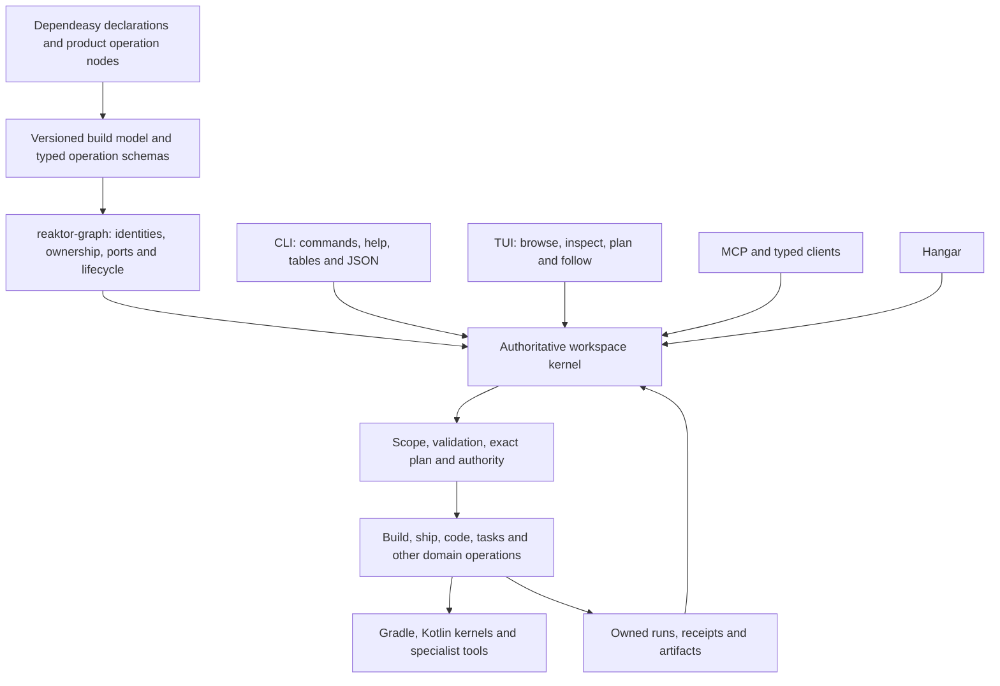

# Reaktor CLI, TUI, Dependeasy and Hangar HLD

Refined 21 October 2026 at the owner's request: a powerful, expressive CLI that is easy to understand. This is the canonical CLI and TUI experience contract. [kernel-handoff.md](kernel-handoff.md) owns package sequencing and qualification; [reaktor-kernel-plan.md](reaktor-kernel-plan.md) owns the broader kernel design; [code-agent-hld.md](code-agent-hld.md) owns code and agent semantics. Where older CLI examples differ, this document's command grammar wins. A documentation revision does not qualify an implementation.

## Goal and delivery status

A person should be able to discover an operation, understand its scope and effects, preview it, execute it and inspect the result without learning how the product is assembled internally. An experienced user should be able to combine those same operations in shell scripts and local CI. Agents should use the same typed contracts and retained references. Power comes from complete domain capabilities, composable arguments and inspectable evidence.

The 20 October [status register](dependeasy-handoff.md#domain-and-legacy-status) records installed CLI/MCP parity for build list/show/tree/explain/kernels across BestBuds, Reaktor and Manna. K1/K3 command consolidation and legacy retirement remain open. One workspace owner is K4; unified approval/ledger behavior is K7. The TUI below is a required planned deliverable, K1-TUI, with no implementation qualification claimed here. The [CLI README](/Users/ovd/dev/bestbuds/targets/reaktorCli/README.md) describes the currently installed interface until cutover.

Success has three observable properties:

- **Understandable:** help explains the user's job, commands follow one grammar, and every result identifies the subject and the next useful action.
- **Expressive:** typed options, scoped discovery, exact references, affected selection, structured output and shell composition cover both common and advanced workflows.
- **Powerful:** every admitted workspace operation is reachable, including product operations, with its full schema, authority and evidence. CLI and TUI are complete clients of the graph-owned capabilities.

## One build model and one operation owner



Arrows describe data and invocation flow, not module imports. Every executable capability is an operation on its owning graph node. Existing typed ports carry invocation, lifecycle and evidence. CLI commands, TUI actions, MCP tools and Hangar controls project the same operation identity and schema. There is no terminal-only catalog, recipe executor, approval store or build graph.

| Owner | Responsibility |
|---|---|
| Dependeasy | Build declarations, immutable specs, Gradle-free kernels, typed tool wrappers, artifact/check relationships, host/toolchain contracts and local CI/build policy |
| reaktor-graph and domain operation nodes | Identity, typed capabilities, ownership, lifecycle and relationships; domain validators and subject resolution |
| Workspace kernel | Catalog, scope, admission, retained plans, operation/run identity, authority, execution coordination and evidence links |
| CLI/TUI in closed BestBuds | Parsing, discovery, presentation, terminal interaction and client lifetime |
| Hangar | Workbench presentation and navigation over the same capabilities |
| Reaktor Code, Conductor and Tooling | Existing source intelligence, agent execution, process supervision and transport mechanisms in their established modules |
| Product composition | Product facts, operations and release policy |

Gradle retains dependency resolution, task planning and incremental scheduling. The kernel coordinates admitted operations; it never recomputes Gradle's task closure. Graph-first does not mean making every log line a node or placing all domain evidence in a new universal database. Link existing evidence owners through typed references. Headless clients must not acquire Compose or workbench dependencies.

## Command model

The canonical grammar is:

```text
reaktor [client options] <domain> <verb> [subject] [typed options]
```

`build.run` becomes `reaktor build run`; `code.query` becomes `reaktor code query`. One operation has one spelling. Domains describe concerns; verbs describe actions; subjects identify existing things. Product/module/task names are subjects, never generated top-level commands. A new package script cannot change a command's meaning. Catalog admission rejects ambiguous command names and collisions with reserved client entry points rather than shadowing a built-in command.

The only non-domain entry points are `--help`, `--version`, `completion`, `tui` and the existing `mcp` transport launcher. Bare `reaktor` prints help; bare `reaktor build` prints build help. Neither starts work or enters a picker. Use `reaktor tui` to request the interactive application explicitly.

### Vocabulary and capability coverage

The table is the target public vocabulary, not a claim that every command ships today. Operations appear when their owning package supplies a qualified schema and implementation. Availability and authority are separate: help may explain an unavailable operation and its remedy, but discovery never grants permission.

| Domain | Jobs and representative commands | Delivery owner |
|---|---|---|
| `build` | `list`, `show`, `tree`, `explain`, `kernels`, `affected`, `plan`, `run`, `receipts` | K1/K3, Dependeasy |
| `ship` | `plan`, `apply`, `verify`, `rollback` against declared delivery nodes | K6, WP20–WP26 |
| `run` | `list`, `show`, `wait`, `logs`, `cancel` for durable runs | K1/K4/K7 |
| `artifact` | `read` for bounded logs, reports, diffs and outputs | Existing evidence owners, K8 |
| `code` / `change` / `check` | Query source; propose/apply an exact change; execute selected checks | Code/agent HLD, K8 |
| `task` / `peer` | Existing task context, continuation and explicit agent cooperation | Conductor, K8 |
| `provider` / `connection` / `workspace` | Configured providers, connection health and explicit workspace/service lifecycle | Existing owners, K4/K8 |
| `operation` | `catalog`, `describe`, `complete` for capability discovery | K1/K8 |

Reuse each domain's existing operation names unless a package explicitly migrates them. The verb set is a vocabulary, not a requirement that every domain implement every verb. Build nodes and agent tasks remain distinct subjects; `run` always means a retained runtime execution. The old `reaktor build <target>` proposal is replaced by `reaktor build run <target>`; old root `plan`, `tasks` and `run <task>` forms are retired at K1 cutover.

### Learning and discovery

Root help answers “what can I do here?” with a small set of grouped workflows, representative examples and the available domains. Domain help answers “which action?” Operation help answers “which inputs and effects?” The catalog remains the complete searchable inventory. Grouping help output does not introduce extra command nesting or aliases.

Every operation's help includes:

- a plain-language purpose and an executable example;
- the subject type, required arguments, defaults and enum values;
- scope, effect and approval expectations;
- whether it reads cached facts, can evaluate Gradle, starts durable work, or contacts a provider;
- the returned value/run/receipt and relevant follow-up command.

Help, version and static completion run outside a repository without scanning source, evaluating Gradle, starting an owner/provider/model or loading GUI code. Workspace help uses a validated cached catalog and labels its freshness. A missing cache shows built-in guidance; it does not silently initialize a workspace. Refresh an unknown operation at most once only during an explicit invocation, then suggest close matches without executing one.

Extend the existing catalog cache with the descriptor/schema metadata needed for offline help and static completion, bound to workspace, wire version and catalog digest. This is disposable owner-derived metadata, not another registry or configuration file. If a field's live schema is absent, help says so and offers explicit `operation describe <operation-id>` to refresh it; it does not start a service to fill the gap. Provider-specific details remain deferred until explicitly requested.

Completion for zsh, bash and fish comes from the same schemas. Dynamic subject completion uses bounded `operation.complete {operation, field, prefix}` reads; it may contact an already running owner but must not start builds, providers or a service just because Tab was pressed. Offline static completion still works. IDs, enums, declared environments and paths have appropriate completion; secret values never do.

### Typed arguments and scope

Keep the ordinary path readable:

```sh
reaktor build tree
reaktor build explain pr
reaktor build plan pr
reaktor build run pr
reaktor build run login --platform ios --flow login-screen
reaktor build affected --since HEAD~1
reaktor code query --paths modules/app --literal SessionKey
```

These are target examples subject to the operation's actual schema. A field is not exposed merely because a terminal example names it. Generate options and validation from the owning serializer/descriptor; extend that descriptor when subject, units, sensitivity, examples or enum descriptions are missing. Do not create a separate CLI schema registry.

- One schema-declared primary subject can be positional. Other fields are named, with consistent kebab-case spelling.
- Required values, defaults, boolean behavior, durations and units are explicit in help. Unknown options and incompatible variants fail before effects.
- Arrays use repeated options, such as `--flow login --flow checkout`. No comma-splitting guesswork. Duplicate scalar options fail rather than silently choosing one.
- Common scalar/enum/list fields get flags. Complex nested input stays available through `--args JSON` or `--args -`; there is no embedded query/programming language.
- JSON input and typed options may fill distinct fields. Supplying the same field in both is an error, including positional subjects. Precedence must not depend on token order.
- `--args -` is the only implicit use of stdin. It reads one bounded JSON object; extra data, invalid types and unknown fields fail. Use normal shell redirection for files.
- `--` ends option parsing. Never interpret a subject, path or string as a shell program. Paths resolve against the explicitly selected workspace, not whichever directory a client last visited.

`--dir` selects the workspace. Preserve the current `--workspace` spelling only as an explicit migration mapping to that same field. Common client options have the same meaning before or after the command; after `--` they are data. Operation options follow the verb. Reserve common option names so descriptor collisions are detected during catalog validation.

Environment and target are explicit operation scope from the delivery/build declaration. CLI scope never changes Hangar's selection. Show the resolved workspace, environment, canonical subject identity and source revision in plans and results. A short name is accepted only when it resolves exactly to one admitted subject; ambiguity returns candidates with qualified IDs. Search can be forgiving; execution cannot.

### Shell composition and machine use

The shell supplies pipes, loops, variables, redirection and scheduling. Do not introduce a parallel workflow language or a local alias/config system. Reusable orchestration belongs in typed product declarations and kernels, where all clients can see it.

```sh
reaktor --dir /Users/ovd/dev/bestbuds build run pr --json > pr-result.json
reaktor build run pr --detach --json
reaktor run show <run-id> --json
reaktor run logs <run-id>
reaktor code query --args - < query.json
```

Angle-bracket references here are placeholders, replaced with returned IDs before execution. JSON results expose typed subject, plan, run and artifact references that can be passed to the next owning command. Scripts do not scrape tables or parse prose. List/filter/cursor arguments belong to their domain schemas and execute as bounded graph/domain queries. Never add a generic `--all`, SQL-like filter language or client-side whole-workspace export to make a common query possible.

## Output and error contract

Human output has a consistent information order: result, subject/scope, important evidence, then next action. Lists are tables; relationships are trees; plans/runs are concise summaries. An inspection result distinguishes declaration facts from observed execution and shows stale/partial/unknown states. Large source, logs and reports are referenced or paginated. Friendly labels accompany complete canonical IDs; narrow layouts wrap or stack identity details rather than truncating IDs. Machine references are always complete.

`--json` writes exactly one complete bounded JSON value to stdout, including rejected and approval-required outcomes. Reuse the existing typed invocation/outcome and domain result contracts; do not invent a second result framework. The stable machine contract carries operation/request identity, resolved scope, outcome, completeness/omissions and retained references where applicable. Schema evolution follows the existing versioned wire. Progress and diagnostics go to stderr; no ANSI, banners, spinner frames or trailing summaries enter JSON. Default JSON execution follows a run and emits its terminal result once; `--detach --json` emits the accepted run once.

Redirecting output disables terminal decoration and interactive prompts. Plain output remains readable; scripts request JSON explicitly. Honor `NO_COLOR` and terminal capabilities, and never use color alone for status. Static completion and MCP stdio write only their respective protocols.

| Exit | Meaning |
|---|---|
| `0` | Completed successfully; or accepted durable work when `--detach` was explicitly requested |
| `1` | Executed work failed, including a failing verification result |
| `2` | Invalid, ambiguous, refused, unsupported, stale or unavailable request; stable error code gives the reason |
| `3` | A human decision/approval is required |
| `124` | A bounded wait expired while the underlying work remains nonterminal |
| `130` | The user interrupted this client; it does not attest cancellation of durable work |

An accepted run is not a passing check. A timeout is not a failed build. Delivery success, domain outcome, execution coverage and parser completeness remain distinct. A partial inspection can succeed while clearly reporting omissions; incomplete required verification cannot be reported as a complete success.

Errors identify the offending field or reference, explain the cause and supply one useful remedy. Examples: unknown `--platfrom` suggests `--platform`; an ambiguous `pr` lists canonical candidates; a stale plan names changed inputs and asks for a fresh plan; an unavailable owner explains the connection/lifecycle command. Suggestions are never auto-executed. A machine error includes the stable code, relevant references and a typed remedy, without secrets or unbounded logs.

## Plans, execution, approvals and interruption

`show`, `tree` and `explain` inspect facts; they do not install tools or execute builds. `plan` is explicit and states its cost: an exact Gradle plan can require configuration and metadata writes. A plan names the requested work, dependency closure, host, environment, effective options, important inputs/outputs and effects, and receives a retained reference. A static declaration tree is never described as the exact Gradle task plan.

`build run <node>` resolves and seals the plan through the owning operation, then executes under policy. A reviewed retained plan can be supplied through the owning run/apply schema; it is not rebuilt silently with different inputs. `ship apply <plan-id>` applies that exact deployment plan. Changed inputs, scope or authority require a new plan/approval. Do not add a universal `--dry-run`, `--force` or `--yes` that changes domain semantics or bypasses a gate.

Run commands follow durable work by default using bounded waits/revision cursors. `--detach` returns the run reference promptly. `run wait`, `run logs`, `run show` and explicit `run cancel` reattach to that identity. Ctrl-C detaches a client and reports the run or, if delivery is uncertain, the request reference. Do not convert a broken connection into an automatic second execution.

`run logs` reads a bounded log page; its schema-owned `--follow` explicitly follows new events in human mode through the owner's watch capability. `--json` returns one bounded page with a cursor. Reject `--follow --json` with a clear remedy to page by cursor or follow the run with progress on stderr; there is no hidden unbounded JSON stream or second event-output format. An operation's wait duration is a domain-owned input, not a new universal timeout setting.

Every effectful invocation creates its request ID before delivery. Return it on both success and uncertain delivery. `--request-id` is the one new common invocation option, for explicit scripting/retry of the same operation and arguments; it maps to the existing invocation field. The owner replays the original result/run, rejects reuse with different arguments and preserves scope/authority checks. Follow-up inspection reconciles uncertainty; the CLI does not manufacture a new ID and retry effects behind the user's back.

A genuinely authenticated human terminal may review the exact plan and answer an approval under existing policy. A TTY is presentation capability, not proof of human identity. An agent's pseudo-terminal or caller-supplied `--seat` cannot grant human authority. Noninteractive approval-required calls return exit 3 and the retained approval reference; another authorized surface can answer it. Environment, principal and effects remain owner-validated on every surface.

## TUI experience

`reaktor tui` launches a keyboard-first terminal application in the same CLI distribution. It is an alternate presentation of the same catalog, invocations and runs. It is not a separate shell, scheduler or embedded kernel. Non-TTY invocation returns a useful error and CLI alternatives. Bare `reaktor` continues to show help.

### Screen structure

```text
Workspace: bestbuds   Environment: dev   Owner: connected   Facts: current
┌──────────────┬───────────────────────────┬─────────────────────────────┐
│ Overview     │ Builds                    │ pr                          │
│ Builds       │ ▾ product                 │ Verify · declared           │
│ Runs         │   clients                 │ Source: build.gradle.kts:…  │
│ Operations   │   services                │ Kernel: WorkspaceCompletion│
│              │ ▾ verification            │ Inputs / outputs / defaults │
│              │   pr                      │ Last run: failed · observed  │
├──────────────┴───────────────────────────┴─────────────────────────────┤
│ Selected run: …   Running   task 8/21   Latest event: …               │
│ / search   Enter inspect   p plan   r run form   : commands   ? help  │
└───────────────────────────────────────────────────────────────────────┘
```

The screen is illustrative; data and actions come from descriptors and owner snapshots. Navigation has four stable views:

- **Overview:** resolved context, owner/model freshness, active runs and actionable failures/approvals.
- **Builds:** the declared product tree, node details, kernels, effective options and source locations. Exact task plans and last receipts are separate expandable facts.
- **Runs:** active/history lists, event/log pages, plan, coverage, artifacts and final receipt for a selected run.
- **Operations:** searchable domains and operations, schema-derived forms, effect/authority, examples and availability. Product ship/code/task operations are available here without bespoke terminal implementations.

The details pane shows provenance, freshness, canonical identity and unavailable reasons. Source/artifact links reuse existing navigation/read capabilities. The context bar is always visible. Changing environment changes only this client's explicit request scope, never another client's selection. Pending plans retain their original scope; a context change cannot silently retarget them.

### Interaction contract

| Key/action | Behavior |
|---|---|
| Arrows, Page Up/Down | Navigate the focused bounded list/tree/log view |
| Tab / Shift-Tab | Move focus between navigation, content and details/forms |
| Enter | Inspect a selection or activate the focused labeled control; selecting a node alone never executes it |
| `/` | Search/filter the focused view, showing whether results cover loaded data or a bounded owner query |
| `:` | Search operation commands; selecting one opens its schema-derived form |
| `p` | Request the selected subject's plan, with any configuration cost explained |
| `r` | Open the run form with typed defaults; submission uses the normal admission path |
| `c` | Open explicit cancellation for the selected run, naming the run and scope |
| `?` | Contextual help, keys, schema and equivalent shell command |
| Esc | Leave search/form/help and return focus without executing an action |
| `q` / Ctrl-C | Exit/detach and restore the terminal; durable work continues |

Printable shortcuts do not fire while typing in a field. No mouse is required. Resize preserves the selected subject and focus; narrow terminals stack content and details. Status has text as well as semantic color. Reuse existing MachineSignal/provenance semantics when adapting color to terminal capabilities; do not invent another status palette or infer assurance from color.

Forms show valid options, defaults and their origins. Variant selection reveals only applicable fields; secret inputs are masked and excluded from history/copy. Validation explains the field error in place and shares the owner's rules. Before an effect, the review names scope, host, options and exact plan/approval identity. Approval controls are available only to an authenticated authorized human. Never turn a fuzzy search match into an implicit run target.

Every form exposes a reproducible shell equivalent using the same typed fields and safe quoting; secret values become explicit placeholders. Copy never includes tokens, credentials or private argument payloads. Completing an operation shows its result/receipt and permits following related runs/artifacts without losing the original selection.

### State and lifecycle

Selection, focus, expanded branches and unsubmitted forms are ephemeral client state. The owner holds runs, approvals, plans and receipts. There is no new terminal database, saved-script format or parallel operation history. Read existing context/preferences only where an established owner already supplies them.

Use the owner's bounded watch/event capability for live state. Maintain cursors and display omitted/older pages honestly. A disconnected view says disconnected and retains its last observed revision; it cannot claim a run is still live or completed. Reconnection resumes reads by identity/revision without replaying effects. Exiting, crashing or resizing the TUI cannot cancel a run or spend an approval. Terminal cleanup occurs on normal exit and interruption.

## Dependeasy integration contract

Consume the current versioned canonical `BuildModel` through the shared `BuildModelReader`, using its schema, validation, freshness and size limits. Preserve full node IDs, declaration/kernel source locations, specs/default origins, invocation, effect/host, tool identities, inputs/outputs, parent/child/consumption relationships and explicit omissions. Do not parse build scripts, infer package aliases or maintain a terminal-specific model reader.

Declarations, exact Gradle plans and execution receipts are separate evidence. Stale facts may be inspected with changed-input warnings; they cannot authorize execution or reuse. A retained stale plan is labeled stale and must be replaced before application. Refresh/export is an explicit build capability, never a side effect of help or ordinary inspection. Configuration, source and toolchain identities participate in invalidation and strong receipt reuse.

`build tree` reads declared hierarchy and can expand qualified retained task-plan facts on explicit request. `build explain` shows resolved fields, defaults, origins, call paths and host. `build affected` identifies relevant nodes through declared input identity and reports incomplete coverage. Typed build options become operation arguments, MCP schema fields and TUI/Hangar form fields from the same definition. The CLI and TUI never add task-path construction or host-selection policy.

## Shared kernel lifetime and Hangar interaction

Normal clients attach to the selected authoritative workspace owner with workspace, incarnation, version, capabilities and authenticated scope validated. Reuse Conductor's supervision and current typed operation transport; share dispatch beneath protocol projections. No implicit fallback to a new independent operational kernel when an owner is unavailable.

Only the owner writes its operational store. GUI and terminal clients hold presentation state. Hangar may host first; the established background service preserves durable work when Hangar closes. CLI/TUI/MCP/Hangar show the same run and receipt and deduplicate the same operation request. A single logical graph does not require merging all domain stores or scheduler responsibilities.

## Migration contract

[kernel-handoff.md](kernel-handoff.md) owns the K1/K3/K4/K7/K10/K1-TUI sequence and related packages. Existing engineering-tool gates remain in [engineering-tools-plan.md](engineering-tools-plan.md); Dependeasy and delivery packages retain their existing prerequisites. This refinement authorizes documentation changes, not implementation out of order or publication.

For every replacement: inventory callers, provide the typed operation, qualify its CLI/MCP/Hangar behavior, migrate scripts/docs, then delete the old parser, discovery and executor. An old spelling may return one actionable replacement error during cutover; it must not remain another executable path. Preserve the explicit `--workspace` root mapping during migration. Package aliases disappear only once their equivalent command is qualified and documented.

Keep internal `reaktor-agent` launchers only for real installed service/MCP dependencies; do not expose another competing user CLI. Preserve active owned configuration and scoped uninstall behavior. The initial rollout qualifies BestBuds, Reaktor and Manna before expanding to other product workspaces. Trim unused legacy code and classpath dependencies after consumer migration; retain useful domain mechanisms in their current owner.

## Acceptance evidence

These are future runtime gates. The current edit qualifies documentation consistency only.

| Scenario | Required evidence and owner |
|---|---|
| First use | A newcomer discovers a build, explains it, plans/runs verification and finds its receipt using shipped help without reading source; K1/K3 |
| Command coverage | Every admitted operation has one canonical command/schema; unavailable capabilities explain why; K1/K8 |
| Startup | Installed help/version/static completion outside a repository: no scans, Gradle/provider/model/service/GUI starts or workspace writes; record cold/warm latency, classpath and baseline comparison; K1 |
| Typed input | Positional/scalar/enum/list/variant/JSON inputs agree across CLI/MCP/TUI; conflicting/unknown input fails before effects; K1/K3/K1-TUI |
| Identity and scope | Ambiguous composite names require selection; canonical IDs round-trip; environment does not mutate Hangar; K3/K10/K11 |
| Machine output | Captured stdout parses as one JSON value for success/failure/denial/approval/detach; stderr contains progress; log pages/cursors and the explicit human follow mode obey their contracts; exit codes agree; K1 |
| Real verification | Installed `build run` reaches a receipt with exact options and truthful coverage; actual failing checks return failure; K1/K3 |
| Shared live work | CLI-created and TUI/Hangar-created runs are mutually visible; only one operational owner writes; clients may exit without killing work; K4/K5/K1-TUI |
| Retry and cancellation | Lost-reply reconciliation uses the same request/run; changed-argument replay is rejected; Ctrl-C detaches and explicit cancel reports observed outcome; K4/K7 |
| Plan and authority | Stale plans cannot apply; real human approval works; noninteractive/agent TTY cannot self-approve; K7/K10 |
| TUI use | Installed PTY walkthrough: browse → inspect → form validation → plan/review → run → logs/receipt; search, focus, narrow resize, disconnect and terminal restoration work; K1-TUI |
| Graph parity | Same canonical nodes, specs, sources, options, relationships and receipts in CLI/TUI/MCP/Hangar; no parallel graph/catalog; K3/K5/K8/K9 |
| Removals | Every migrated package alias/legacy command has a qualified replacement, all callers move, and redundant parsers/executors/dependencies are deleted; K1/K2/K8 |

Use the existing CLI/kernel behavioral checks and real installed shell/PTY scenarios; Hangar behavior uses its existing flows. Do not add kernel unit suites or source-text scans to satisfy this design. Record candidate revision, source/model identity, command, stdout/stderr, exit status, timing and receipt references. Keep failed attempts and partial coverage explicit. Performance and dependency choices need measured evidence, not an unverified library swap.

## Historical evidence

The 9–11 October engineering-tool audit and first-slice qualifications remain historical context in [engineering-tools-plan.md](engineering-tools-plan.md), [code-agent-hld.md](code-agent-hld.md) and the [private implementation record](/Users/ovd/dev/bestbuds/plans/engineering-kernel-implementation.md). Earlier help probes and CLI test runs did not qualify this redesigned grammar, the TUI or one shared live owner. Current build-domain parity is recorded separately in the Dependeasy status register. Never promote a historical or cached pass into acceptance for a changed command, owner or revision.
